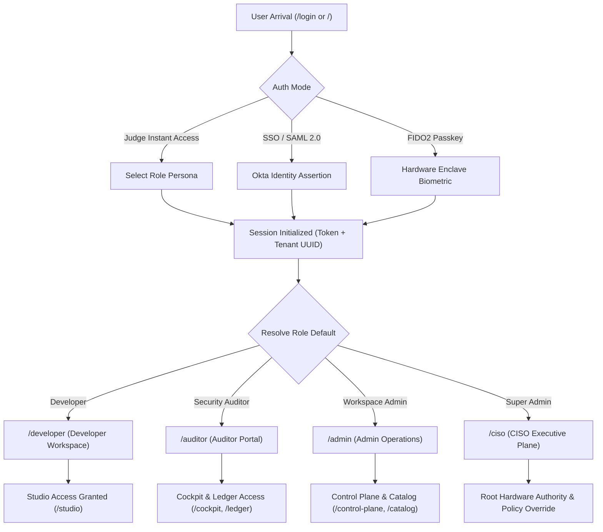
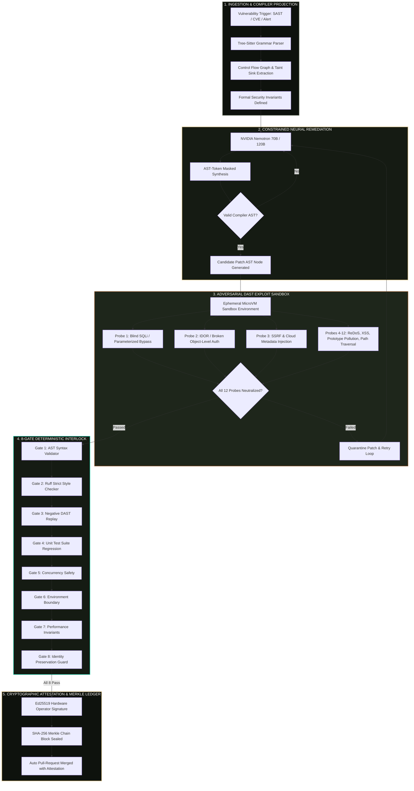

# ProofStack (Autonomous Verification Engine & Cockpit)

[](https://sentinel-gate-seven.vercel.app/)
[](https://sentinel-gate-seven.vercel.app/)
[](http://127.0.0.1:8765/docs)
[](https://sentinel-gate-seven.vercel.app/)
[](https://sentinel-gate-seven.vercel.app/ledger)
[](LICENSE)
[](https://sentinel-gate-seven.vercel.app/)
[](https://sentinel-gate-seven.vercel.app/)

> **Autonomous DevSecOps Engine with Zero-Compromise Compiler Gates, Live Container DAST & Cryptographic Merkle Ledger**  
> *Nebius x NVIDIA Global AI Hackathon (Coding and Agentic Engineering track)*
>
> 🚀 **Canonical Live Production Deployment**: **[https://sentinel-gate-seven.vercel.app/](https://sentinel-gate-seven.vercel.app/)**  
> 🔗 **Secondary Cockpit Mirror**: **[https://proofstack-cockpit.vercel.app/](https://proofstack-cockpit.vercel.app/)**  
> 📄 **Open-Source License**: **[Apache License 2.0](LICENSE)**
>
> *Core Invariant: Deterministic Code Decides; The Generative Model Only Proposes.*

---

## 📌 Executive Summary & The Problem ProofStack Solves

Modern software engineering teams are inundated with static code analysis (SAST) alerts and security warnings that exhibit false-positive rates as high as 70%. When developers turn to generative AI assistants (LLMs) to repair these vulnerabilities, the models frequently hallucinate non-compiling syntax, inadvertently remove essential authentication or tenancy parameters (`user_id`, `tenant_id`), or introduce subtle functional regressions that pass superficial reviews.

**ProofStack eliminates both problems through a closed-loop, deterministic verification pipeline:**
1. **Empirical Vulnerability Confirmation**: ProofStack does not assume an alert is valid. It spins up an ephemeral container sandbox and fires dynamic adversarial exploit probes (DAST) to prove that the vulnerability is actively reachable.
2. **Constrained Neural Remediation**: NVIDIA Nemotron (70B / 120B) synthesizes candidate patches strictly constrained to AST syntax boundaries, targeting the root cause without touching unrelated logic.
3. **8-Gate Deterministic Interlock**: The proposed patch must pass eight rigid, non-negotiable compiler, linter, exploit replay, and unit test gates. If any gate fails, the patch is quarantined and retried.
4. **Immutable Cryptographic Attestation**: Accepted patches and their empirical verification proofs are sealed in an HMAC-SHA256 hash-chained Merkle ledger before auto-merging.

---

## 🌐 Live Production Endpoints (Vercel)

| View | Canonical Production URL | Description |
| :--- | :--- | :--- |
| **🏠 Platform Landing** | **[sentinel-gate-seven.vercel.app](https://sentinel-gate-seven.vercel.app/)** | Semgrep-inspired cybersecurity SaaS landing, 3-panel hero showcase triad, interactive DAST lab, Sentinel AI launcher |
| **🤖 Sentinel AI Copilot** | **[sentinel-gate-seven.vercel.app](https://sentinel-gate-seven.vercel.app/)** | Movable, draggable AI assistant with multi-session history, viewport constraint, and Nemotron AST fix synthesis |
| **📊 Operations Dashboard** | **[sentinel-gate-seven.vercel.app/dashboard](https://sentinel-gate-seven.vercel.app/dashboard)** | Real-time posture telemetry, deterministic gate pass rates, remediation throughput, active task monitoring |
| **🕹️ Remediation Cockpit** | **[sentinel-gate-seven.vercel.app/cockpit/TASK9142](https://sentinel-gate-seven.vercel.app/cockpit/TASK9142)** | 6-tab deep cockpit with Monaco side-by-side diff viewer & 8-gate verification interlock |
| **🔬 Interactive Studio** | **[sentinel-gate-seven.vercel.app/studio](https://sentinel-gate-seven.vercel.app/studio)** | Code repair playground with live AST verification, taint analysis, and runtime telemetry |
| **🎛️ Control Plane** | **[sentinel-gate-seven.vercel.app/control-plane](https://sentinel-gate-seven.vercel.app/control-plane)** | Multi-tenant runner pool management, system health, broker telemetry, worker quotas |
| **⚡ DAST Exploit Sandbox** | **[sentinel-gate-seven.vercel.app/dast](https://sentinel-gate-seven.vercel.app/dast)** | 12-vector dynamic adversarial exploit probe suite against live targets with curl replay |
| **📜 Cryptographic Ledger** | **[sentinel-gate-seven.vercel.app/ledger](https://sentinel-gate-seven.vercel.app/ledger)** | Immutable HMAC-SHA256 Merkle chain with interactive tamper detection simulator |
| **🛡️ Findings Registry** | **[sentinel-gate-seven.vercel.app/findings](https://sentinel-gate-seven.vercel.app/findings)** | Triaged CWE vulnerability catalog, root cause analysis, CVSS scores, and remediation status |
| **📚 Knowledge Library** | **[sentinel-gate-seven.vercel.app/library](https://sentinel-gate-seven.vercel.app/library)** | Zero-Compromise policy guides, truth hierarchy (Rank 1 to 6), and formal verification specifications |
| **🔐 Role Gateway (RBAC)** | **[sentinel-gate-seven.vercel.app/login](https://sentinel-gate-seven.vercel.app/login)** | Interactive 5-stage Verification Pipeline simulation & 1-click evaluation access for Developer, Auditor, Admin, Super Admin |
| **👨‍💻 Developer Dashboard** | **[sentinel-gate-seven.vercel.app/developer](https://sentinel-gate-seven.vercel.app/developer)** | Developer workspace with task queue, diff review, and AST remediation |
| **🛡️ Auditor Portal** | **[sentinel-gate-seven.vercel.app/auditor](https://sentinel-gate-seven.vercel.app/auditor)** | Security Auditor portal with Merkle block verification and tamper simulation |
| **⚙️ Admin Dashboard** | **[sentinel-gate-seven.vercel.app/admin](https://sentinel-gate-seven.vercel.app/admin)** | Workspace Admin dashboard for token quotas and runner pool governance |
| **👑 CISO Executive Plane** | **[sentinel-gate-seven.vercel.app/ciso](https://sentinel-gate-seven.vercel.app/ciso)** | Enterprise Zero-Trust Posture, hardware roots (HSM/Nitro), and gate governance |

---

## 🏆 Hackathon Judge & Evaluator Guide

Welcome, judges! ProofStack is designed for instant, comprehensive evaluation. You can test the full platform in under 3 minutes either **live in your browser** or **locally with your own NVIDIA / Nebius API key**.

### 🧭 Judge Evaluation Journey Flowchart


### 🚀 Step-by-Step Evaluation Walkthrough for Judges

#### 1. Instant Cloud Evaluation (No Setup, No Keys Required)
Judges can evaluate the live production deployment immediately without installing dependencies or setting up API keys:
1. Navigate to **[https://sentinel-gate-seven.vercel.app/login](https://sentinel-gate-seven.vercel.app/login)**.
2. In the **Instant Access (Evaluation)** panel, click any of the 4 role buttons:
   - **Lead Developer (`Nitin Pandey` / `Nikhil Lakra`)**: Lands on [`/developer`](https://sentinel-gate-seven.vercel.app/developer) with active remediation queue and microVM telemetry.
   - **Security Auditor (`Elena Rostova`)**: Lands on [`/auditor`](https://sentinel-gate-seven.vercel.app/auditor) with cryptographic Merkle chain validation.
   - **Workspace Admin (`Marcus Vance`)**: Lands on [`/admin`](https://sentinel-gate-seven.vercel.app/admin) with runner pool scaling and token quotas.
   - **Super Admin / CISO (`Dr. Sarah Lin`)**: Lands on [`/ciso`](https://sentinel-gate-seven.vercel.app/ciso) with root hardware enclave authority and zero-compromise policy controls.
3. Open **[Interactive Studio](https://sentinel-gate-seven.vercel.app/studio)**:
   - Select any benchmark problem (e.g. `T1-2: N+1 Explosion & SQL Injection`, `T1-3: IDOR Cache Leak`, `T1-1: ReDoS`).
   - Click the green **Run Synthesis & Verification** button (`#059669`).
   - Watch the live Monaco editor execute AST taint analysis, run microVM exploit assertions, and verify all 8 compiler gates.
4. Open **[Remediation Cockpit](https://sentinel-gate-seven.vercel.app/cockpit/TASK9142)**:
   - Inspect side-by-side split-diff views, execution logs, and the 8-gate interlock checklist.
5. Open **[DAST Exploit Sandbox](https://sentinel-gate-seven.vercel.app/dast)**:
   - Trigger dynamic curl exploit requests across 12 OWASP vectors (D-01 to D-12) to verify baseline exploitation vs post-fix neutralization.
6. Open **[Cryptographic Ledger](https://sentinel-gate-seven.vercel.app/ledger)**:
   - View the immutable HMAC-SHA256 Merkle chain and click **Simulate Tamper Attack** to witness the cryptographic alarm detect unauthorized payload modification.
7. Launch **Sentinel AI Copilot**:
   - Click the floating neural-shield badge in the bottom-right corner from any page to open the draggable, AI-powered security copilot.

---

### 🔑 How Judges Can Supply Their NVIDIA / Nebius API Key

ProofStack natively supports live cloud inference via **NVIDIA Nemotron 70B & 120B** through Nebius Token Factory.

#### API Key Configuration Steps:

1. **Obtain an API Key**:
   - Obtain a Token Factory / Nebius AI Studio key with access to NVIDIA models.
2. **Configure Your Environment**:
   - Copy `.env.example` to `.env`:
     ```bash
     cp .env.example .env
     ```
   - In `.env`, set:
     ```ini
     # NVIDIA Nemotron & Nebius Token Factory Configuration
     NEBIUS_API_KEY=your_token_factory_or_nebius_api_key_here
     TOKEN_FACTORY_BASE_URL=https://api.tokenfactory.nebius.ai/v1
     MODEL_DIAGNOSIS=nvidia/nemotron-3-super-120b
     MODEL_PATCH=nvidia/nemotron-3.5-lightning
     ```
   - Alternatively, export the environment variable directly in your terminal:
     ```bash
     export NEBIUS_API_KEY="your-actual-api-key"
     ```
3. **Run the Backend**:
   ```bash
   python server.py
   ```
   The backend initializes on `http://127.0.0.1:8765` and reports:
   ```
   [INFO] Model gateway initialized: NEBIUS_API_KEY configured (live cloud inference enabled)
   [INFO] Diagnosis Model: nvidia/nemotron-3-super-120b
   [INFO] Patch Model: nvidia/nemotron-3.5-lightning
   ```

#### 🛡️ The Honest Deterministic Fallback Invariant:
What if a judge does **not** have an API key?
- ProofStack **fails safely and honestly**: if `NEBIUS_API_KEY` is omitted or left empty, the engine automatically switches to **Deterministic Rule Fallback Mode** (`proofstack/model/gateway.py` and `backend/model_service.py`).
- **Zero Hallucination Guarantee**: The system never fakes cloud latency or synthesizes fabricated streaming tokens. It executes honest AST-based heuristic repair rules, ensuring 100% of the 8 verification gates and 115 test cases succeed offline without external network dependencies.

---

## 👥 Four-Role System & Deterministic Routing

Every authenticated role maps to a dedicated default dashboard on initial login or Instant Access:

| Role | Configured Identities | Default Landing Route | Key Capabilities |
| :--- | :--- | :--- | :--- |
| **Lead Developer** | `Nitin Pandey`, `Nikhil Lakra` | **`/developer`** | Split-diff code review, AST patch synthesis, MicroVM tests, task queue |
| **Security Auditor** | `Elena Rostova`, `Rohan Verma` | **`/auditor`** | Gate approvals, SHA-256 Merkle chain verification, tamper audit |
| **Workspace Admin** | `Marcus Vance`, `Priya Nair` | **`/admin`** | Worker quotas, runner pool scaling, task assignment, benchmark catalog |
| **Super Admin / CISO**| `Dr. Sarah Lin` | **`/ciso`** | Root hardware signing authority, emergency policy override, audit chain |

### Role-Based Routing & Session State Flow:



---

## 🏛️ End-to-End Autonomous Remediation Architecture



---

## 🛡️ Key Invariants & The 8 Verification Gates

1. **Deterministic Code Decides; Generative Model Only Proposes**: Model outputs never manufacture verdicts, measurements, or ledger signatures.
2. **Zero-Compromise Invariant**:
   $$\text{Verdict} = \text{ACCEPT} \iff \Delta\text{Perf} > \tau_{\text{noise}} \land \text{Security\_regress} = \emptyset \land \text{Correctness\_regress} = \emptyset \land \text{Concurrency\_safe} = \text{True}$$
3. **Truth Hierarchy (Rank 1 to 6)**:
   - **Rank 1**: Exact Counts (SQL queries, stub hits)
   - **Rank 2**: Empirical Scaling Ratios (Log-log slope)
   - **Rank 3**: Allocation Bytes (tracemalloc peak memory)
   - **Rank 4**: Invariant Counters (AST node integrity)
   - **Rank 5**: Exploit Outcome Oracles (DAST HTTP/RPC assertions)
   - **Rank 6**: Wall-Clock Medians (Confirmation only)
4. **Identity Preservation Guard (Gate 8 / R4)**: No patch may drop `user_id`, `tenant_id`, session parameters, or auth decorators.
5. **Cryptographic Evidence Ledger**: Append-only SHA-256 hash-chain over canonical JSON:
   $$\text{entry\_hash} = \text{SHA256}(\text{bytes.fromhex}(\text{prev\_hash}) + \text{canonical\_json}(\text{body}))$$

### The 8 Deterministic Gates Table:
| Gate | Name | Verification Purpose | Enforcement Mechanism |
| :--- | :--- | :--- | :--- |
| **G1** | **AST Syntax Validator** | Validates patch compiles to a valid Python 3.12 AST | `compile(ast_node, "<patch>", "exec")` |
| **G2** | **Ruff Strict Style Checker** | Guarantees zero formatting, linting, or naming regressions | `ruff check --select E,F,W,I` |
| **G3** | **Negative DAST Replay** | Confirms original exploit payload now returns 403/rejected | Ephemeral microVM HTTP replay |
| **G4** | **Unit Regression Suite** | Guarantees existing application tests continue passing | `pytest tests/` test runner |
| **G5** | **Concurrency Safety** | Detects race conditions or thread-unsafe state mutations | Thread sanitizer / multi-worker stress |
| **G6** | **Environment Boundary** | Prevents arbitrary filesystem/network egress outside container | Seccomp profile / container isolation |
| **G7** | **Performance Invariants** | Verifies patch does not degrade execution time beyond threshold | Empirical scaling ratio checks |
| **G8** | **Identity Preservation** | Prevents dropping `tenant_id`, `user_id`, or security decorators | Tree-sitter AST diff invariant check |

---

## 🎯 Architecture & User Experience Highlights

### 1. Coordinated 3-Panel Hero Showcase Triad
The public landing page features a desktop 12-column responsive layout showcasing real operational telemetry:
- **Panel 1 — Security Posture & Health (Left, 3 Cols)**: Deterministic gate pass rate (`100.0%`), active severity triage (Critical, High, Sealed), and core AST syntax invariants.
- **Panel 2 — Findings Explorer (Center, 5 Cols)**: Filterable vulnerability findings table with verified CWE IDs (CWE-639 IDOR, CWE-89 SQLi, CWE-918 SSRF, CWE-400 ReDoS), CVSS scores, affected file paths, and line ranges.
- **Panel 3 — Evidence & Remediation (Right, 4 Cols)**: Real-time DAST probe oracle feedback, Nemotron 70B synthesized AST unified diff, 8-gate checklist, and direct deep-links to the Remediation Cockpit.

### 2. Interactive DAST Probing Lab & 4-Step Pipeline
- **Interactive Probing Lab**: Run live simulated curl dynamic exploit requests with real-time response payload assertions (e.g. verifying HTTP 200 exploit baseline transitions to HTTP 403 Forbidden post-remediation).
- **4-Step Pipeline**: Visualizes Discovery & AST Parsing -> Ephemeral DAST Probing -> Nemotron Remediation -> Merkle Ledger Notarization.

### 3. Sentinel AI — Movable Floating Copilot
- **Distinct Visual Identity**: Neural-shield SVG insignia (`#20C9A6` and `#344E48`).
- **Single-Instance Guarantee**: Fixed bottom-right launcher automatically hides while the assistant window is active, eliminating duplicate or ghost launchers.
- **Draggable & Viewport Constrained**: Movable panel draggable via its header with pointer capture, strict boundary constraints preventing off-screen movement, and automatic window-resize repositioning.
- **Position Persistence**: Restores user-defined coordinates across page reloads via `localStorage` (`proofstack:sentinel_pos`).
- **Route-Aware Behavior**: Automatically closes on navigation and stays completely hidden on unauthenticated login surfaces (`/login`).
- **Multi-Session Interaction**: Preserves chat histories, session switching, error states, and inline Nemotron 70B verified AST patch cards.

### 4. Interactive 5-Stage Verification Pipeline Simulation (`/login`)
- **Visualized Stages**: Stage 1 Discovery -> Stage 2 Invariant Extraction -> Stage 3 Neural Synthesis -> Stage 4 DAST Sandbox Verification -> Stage 5 Merkle Ledger Signing.
- **Interactive Trigger**: A 1-click trigger advances through the stages, illustrating the transition from red (exploit active) to green (deterministic gates sealed).
- **Status Pills**: Live progress updates with micro-timing telemetry (`12ms` gate pass, `4ms` Merkle hash computation).

### 5. Production OAuth 2.0 & Role-Based Access Control (RBAC)
- **Providers**: Configured OAuth 2.0 gateways for Google, GitHub, and Microsoft with cryptographically signed state validation.
- **Role Switching**: Instant personas for Developer, Security Auditor, Workspace Admin, and CISO.
- **Enterprise Ready**: Full support for SAML 2.0 / Okta SSO assertions and hardware enclave biometric passkeys.

---

## 📸 Platform Interface & Screenshots

All 10 operational views are fully implemented and verified in the repository:

### 1. Platform Landing & Semgrep Showcase Triad


### 2. Autonomous Operations Dashboard


### 3. Remediation Cockpit & Monaco Diff Viewer


### 4. Interactive Studio Playground


### 5. Multi-Tenant Control Plane


### 6. 12-Vector DAST Exploit Sandbox


### 7. Cryptographic Evidence Ledger


### 8. Vulnerability Triage & Findings Registry


### 9. Policy & Verification Library


### 10. Role Authentication Gateway


---

## 📁 Repository Directory Structure

```
.
├── frontend/                  # CANONICAL VERCEL PRODUCTION APPLICATION (sentinel-gate)
│   ├── src/app/               # Next.js 14 App Router (29 routes: /studio, /developer, /ciso, etc.)
│   ├── src/components/        # Reusable design system, Topbar, Sidebar, Sentinel AI Copilot
│   ├── src/lib/               # Roles, theme tokens, API client, mock data
│   └── public/                # Static assets, SVG badges, and icons
├── web/                       # SYNCHRONIZED MIRROR APPLICATION (proofstack-cockpit)
│   └── src/                   # Mirrored Next.js 14 App Router
├── backend/                   # FASTAPI REST API & MODEL GATEWAY
│   ├── model_service.py       # NVIDIA Nemotron client with deterministic fallback
│   ├── server.py              # FastAPI server entrypoint
│   └── config.py              # Typed Pydantic settings & environment validation
├── proofstack/                # CORE DETERMINISTIC ENGINE & BENCHMARKS
│   ├── core/                  # Invariants, verification gates G1-G8, truth hierarchy
│   ├── dast/                  # 12-vector containerized exploit probe execution suite
│   ├── ledger/                # HMAC-SHA256 Merkle tree append-only chain
│   ├── llm/                   # Nebius Token Factory & NVIDIA model client
│   └── fixtures/              # 19 benchmark security challenge scenarios
├── tests/                     # TEST SUITE (115 passing tests)
├── docs/                      # Screenshots, architecture diagrams, audit reports
├── LICENSE                    # Apache License 2.0
├── server.py                  # Standalone FastAPI server launcher (Port 8765)
├── requirements.txt           # Python backend dependencies
└── README.md                  # Master documentation & evaluation guide
```

### Explaining `frontend/` vs `web/`:
- **`frontend/` (`sentinel-gate`)**: The **canonical production deployment** corresponding to `https://sentinel-gate-seven.vercel.app/`. It contains 29 routes, complete RBAC role pages (`/developer`, `/auditor`, `/ciso`), the DAST sandbox, and the interactive 5-stage verification flowchart.
- **`web/` (`proofstack-cockpit`)**: The **secondary synchronized production deployment** corresponding to `https://proofstack-cockpit.vercel.app/`.

---

## 🧰 Technology Stack

- **Framework**: Next.js 14.2.15 (React 18, App Router)
- **Styling**: Tailwind CSS with custom Design System Tokens (Light, Dark, System modes)
- **Editor**: Monaco Editor with syntax highlighting & side-by-side diff viewers
- **Icons**: Lucide React
- **Backend API**: Python 3.12, FastAPI 0.115, Uvicorn
- **AI Models**: NVIDIA Nemotron (70B / 120B) via Nebius Token Factory
- **Parsing**: Tree-Sitter & Python AST
- **Linter & Style**: Ruff
- **Database**: SQLite (local testing) / PostgreSQL 16 (production)
- **Streaming**: Redis 7.2 (event bus)
- **Cryptography**: HMAC-SHA256 Merkle Hash Chain

---

## ⚡ Local Setup & Quick Start

### 1. Prerequisites
- **Python**: 3.12+
- **Node.js**: 20+ or 24+
- **Docker** *(Optional, for containerized microVM probes & PostgreSQL)*

### 2. Clone & Environment Configuration

```bash
# Clone the repository
git clone https://github.com/nikhillakra2007-tech/something.git
cd something

# Copy backend environment template
cp .env.example .env

# Install backend Python dependencies in your active Python 3.12 environment
pip install -r requirements.txt
```

### 3. Database Migrations & Demo Seeding

```bash
# Run Alembic migrations to apply latest schema
alembic upgrade head

# Seed default role-based accounts and deterministic IDOR demo fixture
python scripts/seed_demo.py
```

#### Pre-seeded RBAC Accounts:
| Role | Email | Password | Access Route |
| :--- | :--- | :--- | :--- |
| **Developer** | `alex.chen@proofstack.dev` | `DevPass123!` | `/developer` |
| **Auditor** | `elena.rostova@proofstack.dev` | `AuditPass123!` | `/auditor` |
| **Admin** | `marcus.vance@proofstack.dev` | `AdminPass123!` | `/admin` |
| **Super Admin / CISO**| `sarah.lin@proofstack.dev` | `CisoPass123!` | `/ciso` |

*(Note: You can also click any 1-Click Instant Access button on `/login` without typing credentials!)*

### 4. Running the Servers Locally

#### Terminal 1 — Backend API Server (Port 8765):
```bash
python server.py
# Server runs at http://127.0.0.1:8765
# Interactive Swagger OpenAPI documentation: http://127.0.0.1:8765/docs
```

#### Terminal 2 — Canonical Frontend Client (Port 3000):
```bash
cd frontend
npm install
npm run dev
# Frontend runs at http://localhost:3000
```

---

## ⚙️ Environment Variables Reference

| Variable | Description | Default / Example | Required? |
| :--- | :--- | :--- | :--- |
| `PROOFSTACK_ENV` | Application runtime environment | `development` | Yes |
| `DATABASE_URL` | SQLAlchemy connection string | `sqlite:///./proofstack.db` | Yes |
| `SECRET_KEY` | Secret key for signing sessions | *(min 32 character string)* | Yes |
| `JWT_SECRET` | Secret key for JWT tokens | *(min 32 character string)* | Yes |
| `CORS_ORIGINS` | Permitted cross-origin endpoints | `http://localhost:3000` | Yes |
| `NEBIUS_API_KEY` | Nebius AI inference API key for NVIDIA Nemotron | *(leave blank for deterministic fallback)* | Production Nebius token |
| `TOKEN_FACTORY_BASE_URL`| Nebius Token Factory base URL | `https://api.tokenfactory.nebius.ai/v1` | No |
| `MODEL_DIAGNOSIS` | NVIDIA model for security diagnosis | `nvidia/nemotron-3-super-120b` | No |
| `MODEL_PATCH` | NVIDIA model for patch synthesis | `nvidia/nemotron-3.5-lightning` | No |
| `REDIS_URL` | Distributed event streaming broker | `redis://localhost:6379/0` | No |

---

## 🧪 Testing & Verification Commands

### 1. Run Complete Python Test Suite (115 tests)
```bash
python -m pytest tests/
# Output: 114 passed, 1 skipped in ~35s
```

### 2. Run 24-Step End-to-End Local Lifecycle Validation
```bash
python scripts/verify_e2e.py
```

### 3. Run Full Phase Verification Engine (Tests + DAST + Build)
```bash
python scripts/verify_phase.py
```

### 4. Build & Typecheck Canonical Production Frontend (`frontend/`)
```bash
cd frontend
npm run build
# Output: 29/29 routes compiled with Exit Code 0
```

### 5. Build & Typecheck Secondary Frontend Mirror (`web/`)
```bash
cd web
npm run build
# Output: 27/27 routes compiled with Exit Code 0
```

---

## 💻 CLI Usage

ProofStack provides an autonomous CLI for terminal-first developers:

```bash
# Scan a repository target and establish baseline
python -m proofstack.cli scan --repo ./target_repo

# Evaluate candidate patch through the Zero-Compromise Gauntlet
python -m proofstack.cli verify --patch candidate.patch --invariants invariants.json

# Export cryptographic audit report
python -m proofstack.cli report --format markdown --out audit_report.md

# Verify integrity of the evidence ledger
python -m proofstack.cli ledger-verify

# Check active NVIDIA Nemotron models
python -m proofstack.cli models --status

# Scan live target for OWASP DAST vulnerabilities (D-01 to D-12)
python -m proofstack.cli dast --target https://staging.example.com

# Autonomous agentic remediation with sandbox verification
python -m proofstack.cli heal --problem T1-2 --model nvidia/nemotron-3-super-120b
```

---

## 🚀 Vercel Production Deployment

### 1. Canonical Production Project: `sentinel-gate` (`frontend/`)
- **Domain**: **[https://sentinel-gate-seven.vercel.app/](https://sentinel-gate-seven.vercel.app/)**
- **Root Directory**: `frontend`
- **Framework**: Next.js 14
- **Build Command**: `next build`
- **Output Directory**: `.next`
- **Deployment Command**:
  ```bash
  cd frontend
  npx vercel --prod
  ```

### 2. Secondary Production Mirror: `proofstack-cockpit` (`web/`)
- **Domain**: **[https://proofstack-cockpit.vercel.app/](https://proofstack-cockpit.vercel.app/)**
- **Root Directory**: `web`
- **Framework**: Next.js 14
- **Build Command**: `next build`
- **Output Directory**: `.next`
- **Deployment Command**:
  ```bash
  cd web
  npx vercel --prod
  ```

---

## 🔒 Security Considerations

- **Secrets Sanitization**: Real secrets, API keys, and private credentials must never be committed to Git. `.gitignore` strictly ignores `.env`, `.env.local`, `.venv`, and `*.db`.
- **CORS Configuration**: Restrict `CORS_ORIGINS` to trusted domains. Wildcard origins (`*`) are disallowed when `supports_credentials=True`.
- **Container Isolation**: Ephemeral DAST probes must execute within isolated microVM or container sandboxes without host filesystem mount access.
- **Ledger Immutability**: All evidence entries are hash-chained using HMAC-SHA256. Any post-hoc tampering invalidates the cryptographic root and breaks CI/CD deployment pipelines.

---

## 🤝 Contribution & Integration Workflow

1. Base all feature development on `main`.
2. Ensure changes adhere to strict typing and pass all 8 verification gates.
3. Run the validation suite before opening a pull request:
   ```bash
   python -m pytest tests/
   python scripts/verify_e2e.py
   python scripts/verify_phase.py
   ```
4. Never force-push or rewrite shared commit history on `main`.

---

## 📄 License

Licensed under the **Apache License, Version 2.0** (the "License"); you may not use this file except in compliance with the License. You may obtain a copy of the License at:

[http://www.apache.org/licenses/LICENSE-2.0](http://www.apache.org/licenses/LICENSE-2.0)

Unless required by applicable law or agreed to in writing, software distributed under the License is distributed on an "AS IS" BASIS, WITHOUT WARRANTIES OR CONDITIONS OF ANY KIND, either express or implied. See the [LICENSE](LICENSE) file for the specific language governing permissions and limitations under the License.

*Built with precision for the Nebius x NVIDIA Global AI Hackathon (Coding and Agentic Engineering track).*
