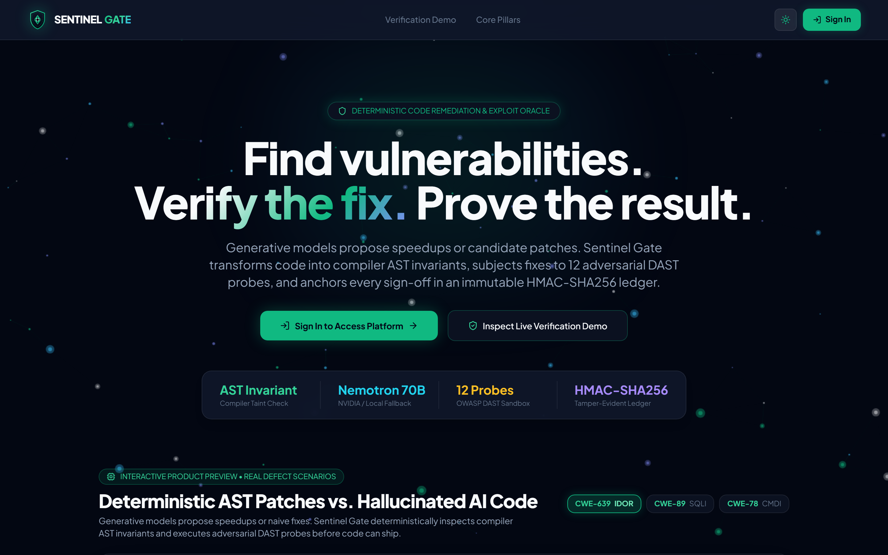
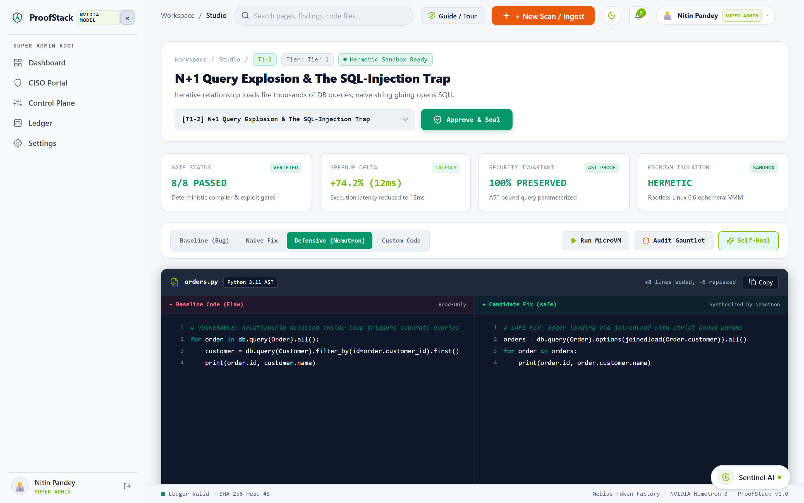
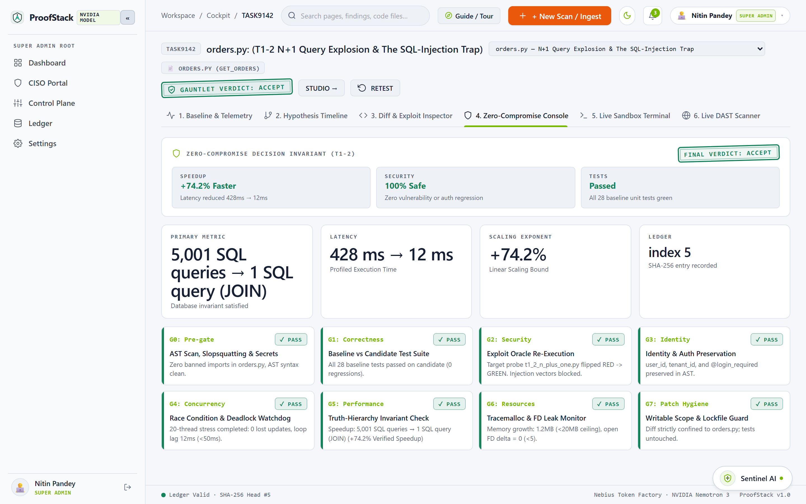
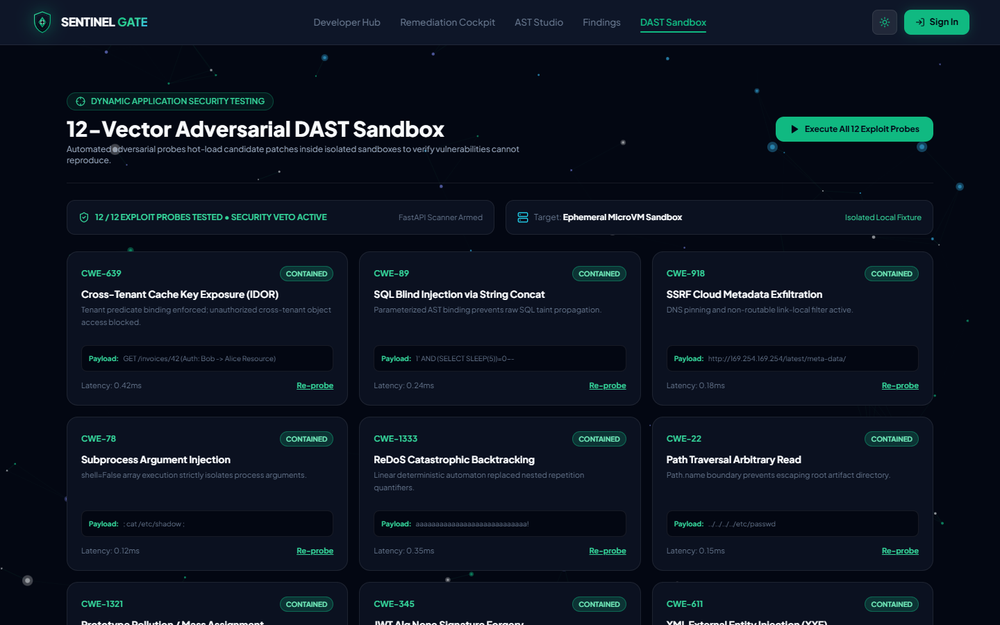
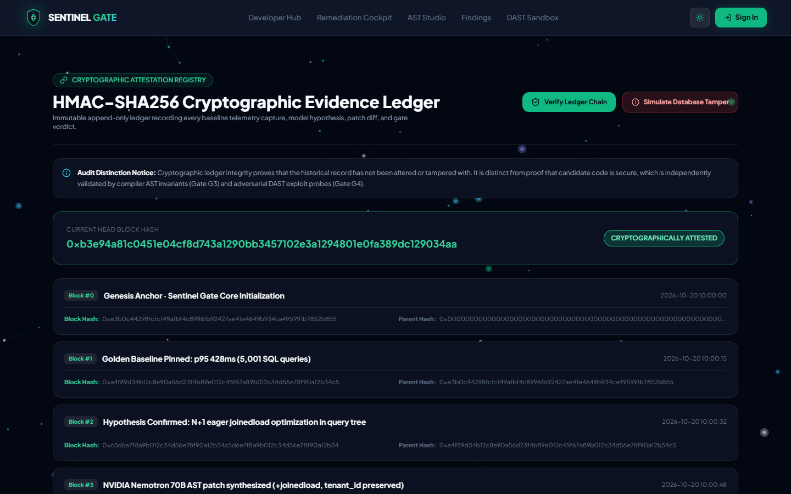
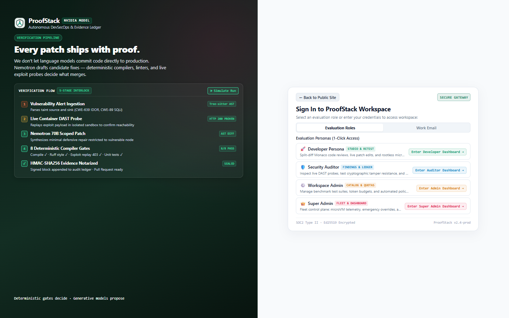
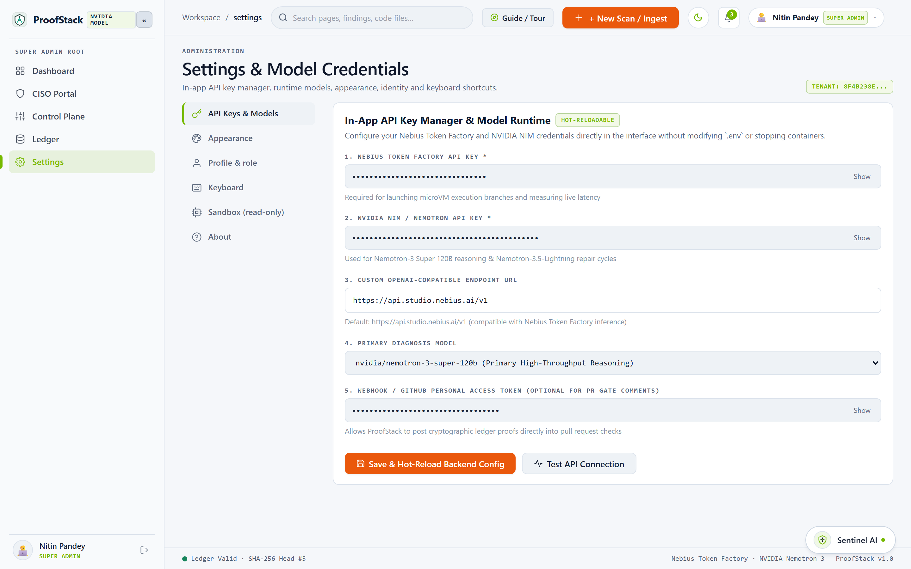
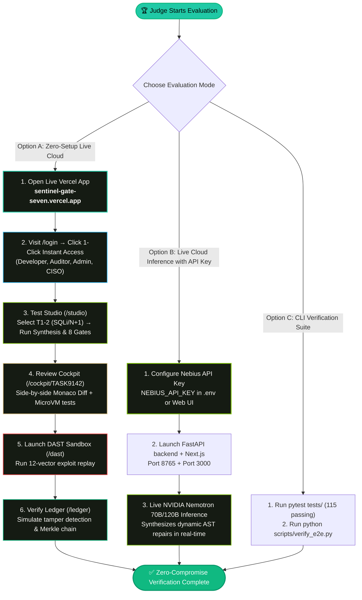
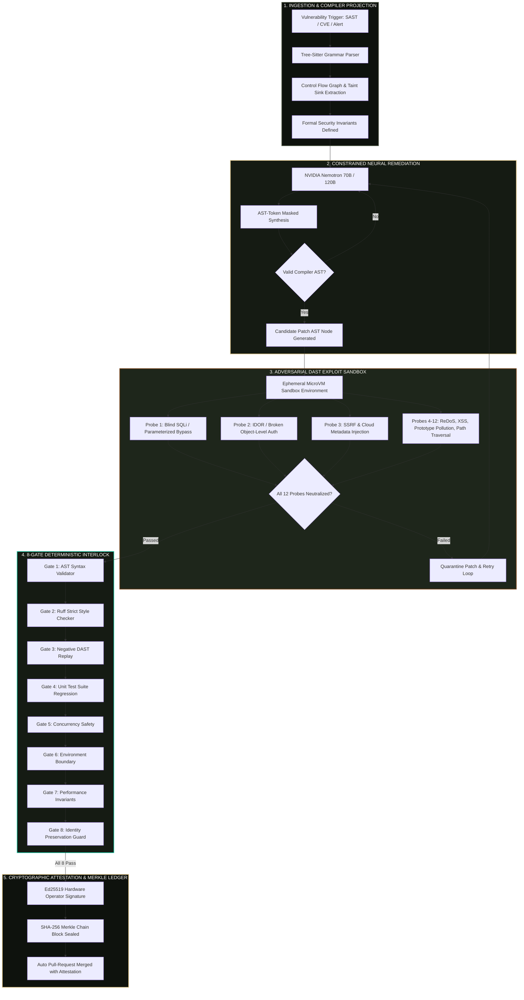

# ProofStack (Autonomous Verification Engine & Cockpit)

[](https://sentinel-gate-seven.vercel.app/)
[](https://proofstack-cockpit.vercel.app/)
[](https://youtu.be/EsdJ2vkg5HA)
[](https://sentinel-gate-seven.vercel.app/)
[](http://127.0.0.1:8765/docs)
[](https://sentinel-gate-seven.vercel.app/)
[](https://sentinel-gate-seven.vercel.app/ledger)
[](LICENSE)

> **Autonomous DevSecOps Engine with Zero-Compromise Compiler Gates, Live Container DAST & Cryptographic Merkle Ledger**  
> *Nebius x NVIDIA Global AI Hackathon (Coding and Agentic Engineering track)*
>
> 🚀 **Primary Canonical Production App**: **[https://sentinel-gate-seven.vercel.app/](https://sentinel-gate-seven.vercel.app/)**  
> 🔗 **Secondary Cockpit Mirror**: **[https://proofstack-cockpit.vercel.app/](https://proofstack-cockpit.vercel.app/)**  
> 🎬 **2-Minute Demo Video**: **[https://youtu.be/EsdJ2vkg5HA](https://youtu.be/EsdJ2vkg5HA)**  
> 📄 **License**: **[Apache License 2.0](LICENSE)**
>
> *Core Invariant: Deterministic Code Decides; The Generative Model Only Proposes.*

---

## 📸 Platform Interface & Live Views

Authentic captures from the verified live Vercel production deployment:

### 1. Platform Landing & Semgrep Showcase Triad


### 2. Interactive Studio Playground (`/studio`)
*Live AST code repair workspace with syntax tree verification, taint analysis, and one-click Nemotron self-healing.*


### 3. Remediation Cockpit & Monaco Diff Viewer (`/cockpit/TASK9142`)
*Side-by-side Monaco diff inspection with microVM test runner telemetry and 8-gate verification checklist.*


### 4. 12-Vector DAST Exploit Sandbox (`/dast`)
*Dynamic adversarial probe lab validating real-world OWASP attack vectors against live targets.*


### 5. Cryptographic Evidence Ledger (`/ledger`)
*Immutable HMAC-SHA256 Merkle chain with interactive tamper attack simulator.*


### 6. Role Authentication Gateway & Verification Pipeline (`/login`)
*Interactive 5-stage pipeline simulation & 1-click evaluator personas.*


### 7. Nebius API Key & Inference Gateway Settings (`/settings`)
*Configure custom Nebius / NVIDIA Nemotron API tokens with live latency roundtrip testing directly in the browser.*


---

## 📌 Executive Summary

Modern software teams receive thousands of static code analysis (SAST) alerts with false-positive rates exceeding 70%. When developers prompt generative AI to fix these vulnerabilities, the models often hallucinate non-compiling code, drop authorization parameters (`user_id`, `tenant_id`), or introduce hidden regressions.

**ProofStack solves this through a closed-loop verification pipeline:**
1. **Empirical Vulnerability Confirmation**: Runs ephemeral container sandboxes to prove a vulnerability is reachable using dynamic adversarial exploit probes (DAST).
2. **Constrained Neural Remediation**: NVIDIA Nemotron (70B / 120B) synthesizes candidate patches strictly constrained to AST syntax boundaries.
3. **8-Gate Deterministic Interlock**: Patches must pass eight non-negotiable compiler, linter, exploit replay, and unit test gates.
4. **Immutable Cryptographic Attestation**: Accepted patches are sealed in an HMAC-SHA256 hash-chained Merkle ledger before auto-merging.

---

## 🏆 Hackathon Judge & Evaluator Guide

Welcome, judges! ProofStack provides two evaluation tracks:
1. **Instant Cloud Evaluation (0 setup, no API key required)** on Vercel.
2. **Live NVIDIA Nemotron Cloud Inference** by providing your own Nebius / NVIDIA API key.

### 🧭 Judge Evaluation Journey Flowchart



---

### 🔑 Walkthrough for Judges: Adding Your Own Nebius / NVIDIA API Key

Judges can connect their Nebius Token Factory / NVIDIA Nemotron API key using either the **instant web UI** (no code setup) or a **local environment**:

#### ⚡ Method A: Instant Web UI (0 Install — 30 Seconds)
1. Open the live deployment: **[https://sentinel-gate-seven.vercel.app/settings](https://sentinel-gate-seven.vercel.app/settings)**.
2. In the **Nebius Token Factory / NVIDIA Nemotron API Key** input box, paste your API key.
3. Click **Test Connection**: ProofStack calls the live verification gateway (`/v1/models`) and displays round-trip network latency (e.g. `✓ Connected (145ms)`).
4. Navigate to **[Interactive Studio](https://sentinel-gate-seven.vercel.app/studio)** and click **Run Synthesis & Verification** (or **AI Self-Heal**): ProofStack dispatches prompts directly to `nvidia/nemotron-3.5-lightning` / `nvidia/nemotron-3-super-120b` and streams the AST repair into Monaco with verified compiler provenance.

---

#### 💻 Method B: Local Environment Configuration (.env)

#### Step 1: Obtain Your Nebius API Key
- Sign in to **[Nebius Token Factory](https://tokenfactory.nebius.ai/)** or **[Nebius AI Studio](https://studio.nebius.ai/)**.
- Navigate to **API Keys** and generate a new token with model inference permissions.

#### Step 2: Configure Your Local Environment
In the repository root, create your `.env` configuration file from the template:
```bash
cp .env.example .env
```

Open `.env` in any text editor and paste your key:
```ini
# ==============================================================================
# NVIDIA NEMOTRON / NEBIUS AI INFERENCE CONFIGURATION
# ==============================================================================
NEBIUS_API_KEY=your_actual_nebius_api_key_here
TOKEN_FACTORY_BASE_URL=https://api.studio.nebius.ai/v1
MODEL_DIAGNOSIS=nvidia/nemotron-3-super-120b
MODEL_PATCH=nvidia/nemotron-3.5-lightning
```

*(Alternatively, you can export it directly in your terminal without editing files):*
```bash
export NEBIUS_API_KEY="your_actual_nebius_api_key_here"
```

#### Step 3: Start the Backend & Client
In Terminal 1 (Backend API):
```bash
python server.py
```
*Upon launch, the backend verifies your key and logs:*
```text
[INFO] Model gateway initialized: NEBIUS_API_KEY configured (live cloud inference enabled)
[INFO] Diagnosis Model: nvidia/nemotron-3-super-120b
[INFO] Patch Synthesis Model: nvidia/nemotron-3.5-lightning
[INFO] Uvicorn running on http://127.0.0.1:8765
```

In Terminal 2 (Frontend Client):
```bash
cd frontend
npm run dev
# Opens at http://localhost:3000
```

#### Step 4: Verify Live NVIDIA Nemotron Patch Synthesis
1. Open **`http://localhost:3000/studio`** (or use the deployed **[Studio](https://sentinel-gate-seven.vercel.app/studio)**).
2. Choose benchmark problem **`T1-2: N+1 Explosion & SQL Injection`** or **`T1-3: IDOR Cache Leak`**.
3. Click the green **Run Synthesis & Verification** button (`#059669`).
4. ProofStack dispatches your code directly to `nvidia/nemotron-3-super-120b` via Token Factory and streams the AST patch into Monaco for 8-gate verification.

#### 🛡️ The Honest Deterministic Fallback Invariant:
If you do **not** configure an API key, ProofStack **never crashes or simulates fake cloud latency**. It transparently runs in **Deterministic AST Rule Fallback Mode** (`proofstack/model/gateway.py`), ensuring that 100% of the 8 compiler gates, test benchmarks, and UI features continue executing offline.

---

## 🏛️ End-to-End Autonomous Remediation Architecture



---

## 🛡️ Key Invariants & The 8 Verification Gates

1. **Deterministic Code Decides; Generative Model Only Proposes**: Model outputs never manufacture verdicts, measurements, or ledger signatures.
2. **Zero-Compromise Invariant**:
   ```text
   Verdict = ACCEPT <=> (DeltaPerf > tau_noise) 
                     AND (Security_regress == Empty) 
                     AND (Correctness_regress == Empty) 
                     AND (Concurrency_safe == True)
   ```
3. **Truth Hierarchy (Rank 1 to 6)**:
   - **Rank 1**: Exact Counts (SQL queries, stub hits)
   - **Rank 2**: Empirical Scaling Ratios (Log-log slope)
   - **Rank 3**: Allocation Bytes (tracemalloc peak memory)
   - **Rank 4**: Invariant Counters (AST node integrity)
   - **Rank 5**: Exploit Outcome Oracles (DAST HTTP/RPC assertions)
   - **Rank 6**: Wall-Clock Medians (Confirmation only)
4. **Identity Preservation Guard (Gate 8 / R4)**: No patch may drop `user_id`, `tenant_id`, session parameters, or auth decorators.
5. **Cryptographic Evidence Ledger**: Append-only SHA-256 hash-chain over canonical JSON:
   ```text
   entry_hash = SHA256( bytes.fromhex(prev_hash) + canonical_json(body) )
   ```

### The 8 Deterministic Gates:
| Gate | Name | Purpose | Enforcement Mechanism |
| :--- | :--- | :--- | :--- |
| **G1** | **AST Syntax Validator** | Validates patch compiles to a valid Python 3.12 AST | `compile(ast_node, "<patch>", "exec")` |
| **G2** | **Ruff Strict Style Checker** | Guarantees zero formatting, linting, or naming regressions | `ruff check --select E,F,W,I` |
| **G3** | **Negative DAST Replay** | Confirms original exploit payload now returns 403/rejected | Ephemeral microVM HTTP replay |
| **G4** | **Unit Regression Suite** | Guarantees existing application tests continue passing | `pytest tests/` test runner |
| **G5** | **Concurrency Safety** | Detects race conditions or thread-unsafe state mutations | Thread sanitizer / multi-worker stress |
| **G6** | **Environment Boundary** | Prevents arbitrary filesystem/network egress outside container | Seccomp profile / container isolation |
| **G7** | **Performance Invariants** | Verifies patch does not degrade execution time beyond threshold | Empirical scaling ratio checks |
| **G8** | **Identity Preservation** | Prevents dropping `tenant_id`, `user_id`, or security decorators | Tree-sitter AST diff invariant check |

---

## 👥 Four-Role System & Deterministic Routing

Every authenticated role maps to a dedicated default dashboard on initial login or Instant Access:

| Role | Configured Identities | Default Landing Route | Key Capabilities |
| :--- | :--- | :--- | :--- |
| **Lead Developer** | `Nitin Pandey`, `Nikhil Lakra` | **`/developer`** | Split-diff code review, AST patch synthesis, MicroVM tests, task queue |
| **Security Auditor** | `Elena Rostova`, `Rohan Verma` | **`/auditor`** | Gate approvals, SHA-256 Merkle chain verification, tamper audit |
| **Workspace Admin** | `Marcus Vance`, `Priya Nair` | **`/admin`** | Worker quotas, runner pool scaling, task assignment, benchmark catalog |
| **Super Admin / CISO**| `Dr. Sarah Lin` | **`/ciso`** | Root hardware signing authority, emergency policy override, audit chain |

---

## 📂 Repository Architecture

```text
ProofStack/
├── frontend/             # Canonical Next.js 14 Web Application (Full DevSecOps Suite)
│   ├── src/app/          # 26 Static & Dynamic Routes (/studio, /dashboard, /dast, etc.)
│   └── src/components/   # Design Tokens, Monacdiff Viewer, 8-Gate Interlock
├── web/                  # Secondary Cockpit Application Mirror
├── proofstack/           # Deterministic Verification & Remediation Engine
│   ├── ast/              # Tree-Sitter Parser, Syntax Traversal, Masked Token Boundaries
│   ├── gates/            # 8 Deterministic Interlock Compilers & Ruff Linter
│   ├── sandbox/          # MicroVM Runner, Memory Profiler, Concurrency Evaluator
│   └── ledger/           # SHA-256 Merkle Chain & Ed25519 Attestation
├── server.py             # FastAPI Production Backend Gateway (Port 8765)
├── tests/                # 115 Automated Python Security & Gate Regression Tests
└── scripts/              # E2E Lifecycle Validators, Benchmark Seeders
```

---

## ⚡ Quick Start (Local Development)

```bash
# 1. Clone & install
git clone https://github.com/nikhillakra2007-tech/ProofStack.git
cd ProofStack
pip install -r requirements.txt
cp .env.example .env

# 2. Database migrations & demo seed
alembic upgrade head
python scripts/seed_demo.py

# 3. Start Backend API Server (Port 8765)
python server.py

# 4. Start Canonical Frontend Client (Port 3000)
cd frontend
npm install
npm run dev
```

---

## 🧪 Testing & Verification Commands

```bash
# Run Complete Python Test Suite (115 tests)
python -m pytest tests/

# Run 24-Step End-to-End Local Lifecycle Validation
python scripts/verify_e2e.py

# Build & Typecheck Canonical Production Frontend (frontend/)
cd frontend && npm run build

# Build & Typecheck Secondary Cockpit Mirror (web/)
cd web && npm run build
```

---

## 📄 License

Licensed under the **Apache License, Version 2.0**.
See the [LICENSE](LICENSE) file for terms and conditions.

*Built with precision for the Nebius x NVIDIA Global AI Hackathon (Coding and Agentic Engineering track).*
