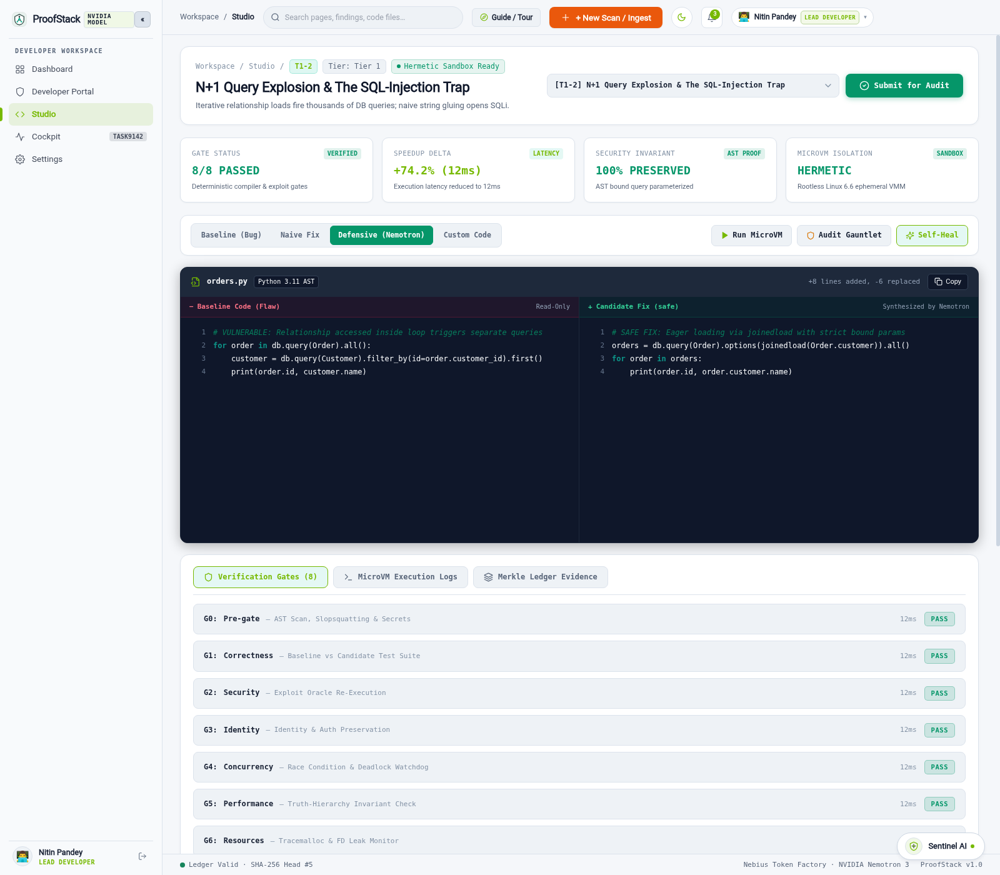

# ProofStack

**The model proposes, the gates decide.** Autonomous code repair where NVIDIA Nemotron patches are gated by eight deterministic checks and sealed in a SHA-256 hash-chained evidence ledger.

[Live demo](https://proofstack-app.vercel.app/) | [Cockpit](https://proofstack-cockpit.vercel.app/)



## Quickstart

```bash
git clone https://github.com/nikhillakra2007-tech/ProofStack.git
cd ProofStack

cp .env.example .env
# add NEBIUS_API_KEY and DATABASE_URL
docker compose up -d        # postgres + redis

pip install -r requirements.txt
pip install -r requirements-dev.txt   # to run the test suite
alembic upgrade head
python scripts/seed_demo.py
python server.py                     # API on http://127.0.0.1:8765
cd frontend && npm install && npm run dev   # app on http://localhost:3000
```

The offline deterministic fallback runs without an API key, so anyone can try it for free.

## The eight gates

Every model-proposed patch must pass all eight deterministic gates before it is accepted. Deterministic code decides; the generative model only proposes.

1. **G0 Pre-Gate** - catches supply-chain and unsafe-code problems before anything runs: import allowlist vs lockfile (slopsquatting), secret scanning, and banned constructs like `shell=True` and `pickle.loads`.
2. **G1 Correctness** - catches regressions: any previously passing test that fails on the candidate patch blocks it.
3. **G2 Security** - catches patches that don't actually fix the vulnerability: every applicable exploit probe must flip to green, and untouched security probes must stay green.
4. **G3 Identity-Preservation** - catches patches that drop or weaken authorization: `user_id`, `tenant_id`, session parameters, and auth decorators may not be removed or bypassed.
5. **G4 Concurrency** - catches race conditions, lost updates, deadlocks, and event-loop blocking introduced by the patch.
6. **G5 Performance** - catches fake or noisy performance claims: speedups are verified against a ranked truth hierarchy, not wall-clock luck.
7. **G6 Resources** - catches leaks: memory growth, file-descriptor leaks, and unreleased database connections.
8. **G7 Patch Hygiene** - catches scope creep: only files in the declared writable paths may be edited.

## The two frontend trees (temporary)

This repo currently contains two Next.js apps. `web/` (package `proofstack-cockpit`) is the earlier snapshot that powers https://proofstack-cockpit.vercel.app; `frontend/` (package `proofstack`) is the newer canonical app. Both deployments are live, so `web/` is kept until the cockpit Vercel project is repointed at `frontend/` (Vercel project settings, root directory) or retired - then `web/` gets removed. New UI work lands in `frontend/`.

## Why this exists

AI writes patches faster than people can review them. The bottleneck in code repair is no longer generation - it is trust. A model that proposes a plausible patch is cheap; proving the patch compiles, fixes the vulnerability, preserves authorization, and doesn't regress anything is the hard part. ProofStack closes that gap: Nemotron proposes, and eight deterministic gates decide.

## DAST sandbox and evidence ledger

Before a patch is even proposed, ProofStack proves the vulnerability is real by replaying adversarial exploit probes against an ephemeral container sandbox (DAST), so teams stop triaging static-analysis noise. After the gates accept a patch, the decision is sealed in an append-only evidence ledger: a SHA-256 hash chain over canonical JSON where every entry links to the previous one, so tampering with any record is detectable. Accepted patches are emitted as a verdict, a diff and a report with that attestation attached. ProofStack never pushes, merges or deploys - merging stays a human decision.

[](tests/)

## License

[Apache License 2.0](LICENSE)
