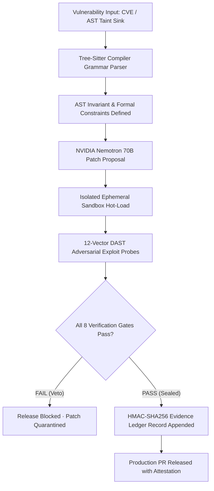

# Sentinel Gate — Autonomous AST Security Verification & Cryptographic Remediation

[](https://sentinel-gate-seven.vercel.app)
[](https://sentinel-gate-seven.vercel.app)
[](http://127.0.0.1:8765/docs)
[](https://sentinel-gate-seven.vercel.app)
[](https://sentinel-gate-seven.vercel.app/ledger)

> **Live Production Platform**: **[https://sentinel-gate-seven.vercel.app](https://sentinel-gate-seven.vercel.app)**  
> *Operational Invariant: Deterministic Code Decides; The Generative Model Only Proposes.*

---

## 🌐 Production Modules & Dedicated Workspaces

Public visitors access the core platform demonstration. Authenticated operators are routed strictly into their authorized workspace:

| Module / Route | Live URL | Description & Operational Scope |
| :--- | :--- | :--- |
| **Public Overview** | **[sentinel-gate-seven.vercel.app](https://sentinel-gate-seven.vercel.app)** | Core value proposition, live AST verification terminal, and four defense pillars. |
| **Authentication Gateway** | **[sentinel-gate-seven.vercel.app/login](https://sentinel-gate-seven.vercel.app/login)** | Role-based clearance portal routing operators directly into their assigned workspace. |
| **Lead Developer Hub** | **[sentinel-gate-seven.vercel.app/developer](https://sentinel-gate-seven.vercel.app/developer)** | Tree-Sitter grammar inspector, AST invariants, and candidate patch diffs. |
| **Security Auditor Hub** | **[sentinel-gate-seven.vercel.app/auditor](https://sentinel-gate-seven.vercel.app/auditor)** | HMAC-SHA256 ledger verification, adversary tamper simulation, and audit exports. |
| **Operations Admin Hub** | **[sentinel-gate-seven.vercel.app/admin](https://sentinel-gate-seven.vercel.app/admin)** | Ephemeral microVM sandbox pools, NVIDIA token quotas, and webhook dispatchers. |
| **SuperAdmin (CISO) Hub** | **[sentinel-gate-seven.vercel.app/ciso](https://sentinel-gate-seven.vercel.app/ciso)** | Zero-trust security posture, compliance mappings (SOC2/FedRAMP), and policy gates. |
| **Remediation Cockpit** | **[sentinel-gate-seven.vercel.app/cockpit](https://sentinel-gate-seven.vercel.app/cockpit)** | Side-by-side diff with dynamic 8-gate deterministic security interlock. |
| **AST Synthesis Studio** | **[sentinel-gate-seven.vercel.app/studio](https://sentinel-gate-seven.vercel.app/studio)** | Custom code invariant synthesis powered by NVIDIA Nemotron 70B templates. |
| **Vulnerability Feed** | **[sentinel-gate-seven.vercel.app/findings](https://sentinel-gate-seven.vercel.app/findings)** | Real-time taint sink registry with CWE classifications and severity filters. |
| **12-Vector DAST Sandbox** | **[sentinel-gate-seven.vercel.app/dast](https://sentinel-gate-seven.vercel.app/dast)** | Adversarial exploit testing suite across isolated container targets. |
| **Evidence Ledger** | **[sentinel-gate-seven.vercel.app/ledger](https://sentinel-gate-seven.vercel.app/ledger)** | Immutable append-only cryptographic record with live tamper detection. |
| **Platform Settings** | **[sentinel-gate-seven.vercel.app/settings](https://sentinel-gate-seven.vercel.app/settings)** | Host NVML GPU detection, model endpoint controls, and variance noise thresholds. |

---

## 🏛️ System Architecture



---

## 🛡️ The 8 Deterministic Verification Gates

| Gate | Name | Verification Check |
| :---: | :--- | :--- |
| **G0** | **AST Parser Guard** | Tree-Sitter grammar parse validation; rejects illegal syscalls or imports. |
| **G1** | **Regression Suite** | Functional test execution; ensures zero semantic drift from existing tests. |
| **G2** | **Exploit Oracle** | Injection of 12 adversarial CWE payloads; confirms exploit cannot reproduce. |
| **G3** | **Identity Tenancy Guard** | Multi-tenant predicate verification; ensures cross-tenant isolation survives refactoring. |
| **G4** | **Concurrency Invariant** | Parallel executor stress test; checks for deadlocks, race conditions, and lost updates. |
| **G5** | **Performance Delta** | Latency benchmarking against golden baseline; ensures p95 latency does not regress. |
| **G6** | **Memory Hygiene** | tracemalloc heap allocation monitor; enforces strict memory growth ceilings. |
| **G7** | **Deterministic Sign-off** | Static analysis ensuring zero hardcoded secrets or unparameterized dynamic calls. |

---

## ⚡ The 12 Adversarial DAST Vectors

| Vector | CWE | Target Flaw | Verification Standard |
| :---: | :--- | :--- | :--- |
| **P01** | CWE-639 | Cross-Tenant Cache Key Exposure (IDOR) | Tenant predicate strictly partitions cache and database queries. |
| **P02** | CWE-89 | SQL Injection via String Concatenation | Parameterized statement binding prevents raw SQL taint propagation. |
| **P03** | CWE-918 | SSRF Cloud Metadata Exfiltration | DNS pinning and non-routable link-local filter active. |
| **P04** | CWE-78 | Subprocess Argument Injection | shell=False array execution isolates process arguments. |
| **P05** | CWE-1333 | ReDoS Catastrophic Backtracking | Linear deterministic automaton replaces nested repetition quantifiers. |
| **P06** | CWE-22 | Path Traversal Arbitrary Read | Canonical path resolution isolates root artifact directory. |
| **P07** | CWE-1321 | Prototype Pollution / Mass Assignment | Strict schema validation rejects magic attributes and unbound keys. |
| **P08** | CWE-345 | JWT Algorithm None Signature Forgery | Unverified 'none' algorithm rejected by authentication provider. |
| **P09** | CWE-611 | XML External Entity Injection (XXE) | External entity resolution disabled in XML/DOM parser. |
| **P10** | CWE-502 | Insecure Python Pickle Deserialization | Pickle deserialization replaced with safe JSON schemas. |
| **P11** | CWE-1336 | Server-Side Template Injection (SSTI) | Sandboxed template context prohibits expression evaluation. |
| **P12** | CWE-113 | CRLF Log Injection & Header Splitting | HTTP header sanitization strips control linefeed characters. |

---

## 🚀 Local Execution

### 1. Backend Engine (FastAPI on Port 8765)
```bash
python server.py
```
- Health Check: `curl http://127.0.0.1:8765/api/health`
- Swagger Documentation: `http://127.0.0.1:8765/docs`

### 2. Frontend Application (Next.js 14 on Port 3000)
```bash
cd frontend
npm install
npm run dev -p 3000
```
- Web Application: `http://localhost:3000`

### 3. Automated Test Suite
```bash
python -m pytest tests/ -v
```

---

## 📄 License

Licensed under the Apache 2.0 License.
