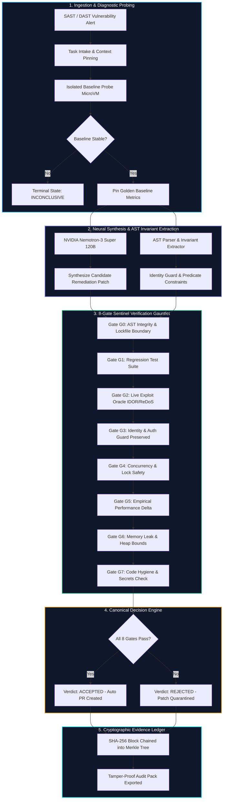

# ProofStack — Autonomous Verification & Cryptographic Remediation Engine

> **Zero-Compromise Security & Performance Verification Platform with NVIDIA Nemotron & SHA-256 Evidence Ledger**  
> *Engineered for High-Assurance AI Patch Synthesis, Live DAST Remediation, and Cryptographic Audit Compliance.*

```
Deterministic Code Decides; The LLM Only Proposes.
```

---

## 🌟 Executive Summary

**ProofStack** is an autonomous verification and self-healing DevSecOps platform. It bridges generative AI code generation with production engineering by enforcing a core invariant: **an AI model proposes candidate remediations, but deterministic verification engines, AST invariant guards, and hardware-isolated test microVMs determine whether any patch ships.**

Every verified patch, gate outcome, and test artifact is permanently sealed into a **tamper-evident SHA-256 Merkle hash chain**, providing non-repudiable audit trails for security architects and compliance officers.

---

## 🏛️ System Architecture



---

## 🛡️ The 8 Sentinel Verification Gates

| Gate | Gate Name | Enforcement Mechanism | Failure Action |
| :---: | :--- | :--- | :--- |
| **G0** | **AST Integrity** | Checks AST parse tree, imports, and lockfile constraints. | Immediate rejection; prevents syntax/runtime breakage. |
| **G1** | **Regression Suite** | Executes full unit/integration test suite in isolated runner. | Rejection on any broken test case or semantic drift. |
| **G2** | **Exploit Oracle** | Replays real IDOR, SQL injection, and ReDoS attack vectors. | Patch rejected if any exploit payload succeeds. |
| **G3** | **Identity Guard** | AST verification that user tenancy predicates are retained. | Hard block; guarantees multi-tenant boundary integrity. |
| **G4** | **Concurrency Safety** | Thread and asyncio deadlock detection under load. | Flags lost updates, race conditions, and hung locks. |
| **G5** | **Empirical Performance** | Measures p95 latency speedup above 5% noise floor. | Fails if patch introduces performance regression. |
| **G6** | **Memory Hygiene** | Python `tracemalloc` telemetry capped at 20MB delta. | Blocks memory leaks and unbounded buffer allocations. |
| **G7** | **Supply Chain Hygiene** | Scans for hardcoded secrets, `eval()` calls, and typosquatting. | Absolute zero-compromise security block. |

---

## 🎨 Frontend Architecture & Motion Design

The frontend is built on **Next.js 14**, **Tailwind CSS**, and **Framer Motion**, drawing inspiration from modern financial architectures like [Finroq](https://github.com/nikhillakra2007-tech/finroq) while establishing a distinct **Quantum Aurora** cybernetic aesthetic.

```
web/src/
├── app/                      # Next.js App Router (Full-Screen Layouts)
│   ├── page.tsx              # Adaptive Switcher (Public Landing vs Sentinel Hub)
│   ├── home/                 # Marketing Landing Page with Interactive Bento
│   ├── login/                # 1-Click Role Switcher & Live Evidence Feed
│   ├── cockpit/[taskId]/     # Remediation Cockpit (Dual AST Diff vs Naive Patch)
│   ├── studio/               # Interactive AST Repair Environment
│   ├── findings/             # Security & Performance Findings Triage
│   ├── dast/                 # 12-Check OWASP Dynamic Scanner
│   ├── ledger/               # Merkle SHA-256 Ledger & Tamper Simulator
│   ├── catalog/              # 19-Problem Benchmark Catalogue
│   ├── control-plane/        # SuperAdmin MicroVM Governance & Quotas
│   └── settings/             # Model Credentials & Platform Preferences
│
└── components/               # Strictly Organized (1-2 Files Max Per Folder)
    ├── animations/           # Reveal.tsx, ScrollReveal.tsx
    ├── boot-sequence/        # BootSequence.tsx (Cinematic Telemetry Simulation)
    ├── dashboard-sections/   # DashboardSections.tsx (Visual Multi-Section Hub)
    ├── footer/               # Footer.tsx (High-Tech Engineering Footer)
    ├── hero-visual/          # HeroVisual.tsx (Live Safe vs Naive Patch Simulator)
    ├── horizon-nav/          # HorizonNav.tsx (Sticky Horizon Dock & Scroll Progress)
    ├── layout/               # CurtainTransition.tsx, MainLayout.tsx
    ├── ledger-visual/        # LedgerVisual.tsx (Interactive Merkle Chain Viewer)
    ├── philosophy-visual/    # PhilosophyVisual.tsx (Dual-Engine Comparison Bento)
    ├── pipeline-visual/      # PipelineVisual.tsx (5-Stage Pipeline Inspector)
    └── scroll-provider/      # ScrollProvider.tsx (Smooth Momentum Scrolling)
```

### Signature Visual Features:
- **Horizon Navigation Dock**: Zero vertical sidebars. Sticky frosted-glass capsule dock with animated layout indicator pills.
- **Curtain Transitions (`navigateWithCurtain`)**: Cinematic full-screen curtain sweeps during route changes with contextual page branding.
- **Cinematic Boot Sequence**: 5-step hardware telemetry progression on first visit (or on demand via navbar).
- **Quantum Aurora Palette**: Cosmic Obsidian (`#07090E`), Electric Cyan (`#00F0FF`), Quantum Indigo (`#818CF8`), Emerald (`#10B981`), and Vivid Crimson (`#F43F5E`).
- **Dynamic Scroll Progress**: 2.5px glowing cyan-indigo gradient bar tied to real-time viewport progression.

---

## ⚡ Quickstart & Local Execution

### 1. Prerequisites
- **Python 3.10+** (FastAPI, Uvicorn, SQLAlchemy)
- **Node.js 18+** & `npm` (Next.js 14)

### 2. Start the FastAPI Backend
```bash
# Initialize DB tables
python -c "from backend.database import Base, engine; from backend import models; Base.metadata.create_all(bind=engine)"

# Run backend daemon on port 8000
python -m uvicorn backend.server:app --host 127.0.0.1 --port 8000
```
*Health Check:* `http://127.0.0.1:8000/api/health` → `{"status": "ok", "version": "0.1.0"}`

### 3. Start the Next.js Frontend
```bash
cd web
npm install
npm run dev -p 3000
```
*Frontend URL:* **[http://localhost:3000](http://localhost:3000)**

---

## 🔗 Platform Navigation Guide

| Route | Purpose | Key Capabilities |
| :--- | :--- | :--- |
| **[`/`](http://localhost:3000/)** | **Hub & Overview** | Adaptive view: Visitor showcase or multi-section Sentinel cockpit. |
| **[`/login`](http://localhost:3000/login)** | **Role Switcher** | 1-click preset operator access: Lead Developer, Security Auditor, Operations Admin, SuperAdmin. |
| **[`/cockpit/TASK9142`](http://localhost:3000/cockpit/TASK9142)** | **Remediation Cockpit** | Side-by-side AST Hardened diff vs Naive patch, 8-gate radar, live candidate execution. |
| **[`/studio`](http://localhost:3000/studio)** | **Repair Studio** | Interactive Nemotron repair iterations, defect class injection, and patch synthesis. |
| **[`/findings`](http://localhost:3000/findings)** | **Vulnerability Feed** | Triaged DAST and static analysis findings with automatic truth ranking. |
| **[`/dast`](http://localhost:3000/dast)** | **OWASP DAST Scanner** | 12 live telemetry probes (Security headers, CSP depth, cookie flags, credential leaks). |
| **[`/ledger`](http://localhost:3000/ledger)** | **Cryptographic Ledger** | SHA-256 Merkle chain verification with live block tamper simulation and export. |
| **[`/catalog`](http://localhost:3000/catalog)** | **Benchmark Catalogue** | 19 reproducible performance and security defect classes across Tier 1, 2, and 3. |
| **[`/control-plane`](http://localhost:3000/control-plane)** | **Governance Console** | MicroVM worker allocation, team token budgets, and emergency policy override. |
| **[`/settings`](http://localhost:3000/settings)** | **Configuration** | In-app API keys for NVIDIA Nemotron & Nebius Token Factory, themes, and shortcuts. |

---

## 🔐 Cryptographic Ledger Formula

Every ledger block is immutable and cryptographically bound to the previous block:

$$\text{entry\_hash} = \text{SHA256}(\text{bytes.fromhex}(\text{prev\_hash}) + \text{canonical\_json}(\text{block\_body}))$$

If an adversary tampers with any block payload or timestamp, the hash chain immediately breaks, triggering an automated quarantine on the release pipeline.

---

## 📄 License & Attribution

ProofStack is engineered for the **Nebius × NVIDIA Global AI Hackathon** (Track 1: Coding & Agentic Engineering).  
Licensed under the Apache 2.0 License.
