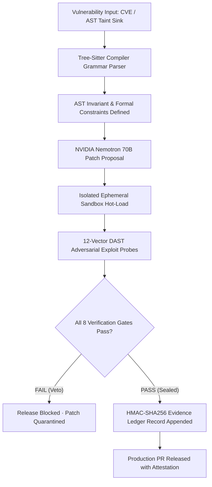

# Sentinel Gate — Autonomous AST Security Verification & Cryptographic Remediation

[](https://sentinel-gate-seven.vercel.app)
[](https://sentinel-gate-seven.vercel.app)
[](http://127.0.0.1:8765/docs)
[](https://sentinel-gate-seven.vercel.app)
[](https://sentinel-gate-seven.vercel.app/ledger)

> **Live Production Platform**: **[https://sentinel-gate-seven.vercel.app](https://sentinel-gate-seven.vercel.app)**  
> *Core Invariant: Deterministic Code Decides; The Generative Model Only Proposes.*

---

## 📸 Platform Interface & Screenshots

### 1. Platform Landing & Live AST Verification Terminal
Interactive real-time vulnerability terminal featuring live payload injection, AST invariant synthesis, and live pass/fail gating:


### 2. Remediation Cockpit
Side-by-side AST syntax diff with dynamic 8-gate deterministic security interlock and live attestation sealing:


### 3. 12-Vector DAST Sandbox
Adversarial exploit validation suite testing candidate patches against real-world CWE payloads in isolated execution environments:


### 4. Cryptographic Evidence Ledger
Immutable HMAC-SHA256 audit ledger tracking all remediation decisions with real-time cryptographic tamper detection:


### 5. Role Authentication Gateway
Dedicated access clearance routing operators strictly into their authorized workspace (Lead Developer, Security Auditor, Operations Admin, SuperAdmin CISO):


---

## 🏛️ System Architecture



---

## 🛡️ Core Verification Interlocks

- **8 Deterministic Gates**: AST Parser Guard (`G0`), Regression Suite (`G1`), Exploit Oracle (`G2`), Identity Tenancy Guard (`G3`), Concurrency Invariant (`G4`), Performance Delta (`G5`), Memory Hygiene (`G6`), Deterministic Sign-off (`G7`).
- **12 DAST CWE Vectors**: Coverage across IDOR (`CWE-639`), SQLi (`CWE-89`), SSRF (`CWE-918`), Command Injection (`CWE-78`), ReDoS (`CWE-1333`), Path Traversal (`CWE-22`), Prototype Pollution (`CWE-1321`), JWT Algorithm None (`CWE-345`), XXE (`CWE-611`), Pickle Deserialization (`CWE-502`), SSTI (`CWE-1336`), and CRLF Header Splitting (`CWE-113`).

---

## 🚀 Local Quickstart

### 1. Backend Engine (FastAPI)
```bash
python server.py
```
- Health API: `http://127.0.0.1:8765/api/health`
- Swagger UI: `http://127.0.0.1:8765/docs`

### 2. Frontend Application (Next.js 14)
```bash
cd frontend
npm install
npm run dev
```
- Local Application: `http://localhost:3000`
- Production Deployment: `https://sentinel-gate-seven.vercel.app`

---

## 📄 License
Apache-2.0 License.
