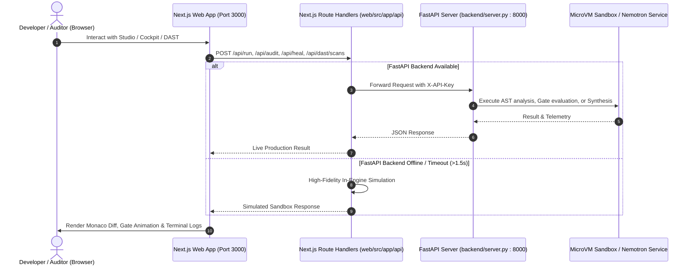

# ProofStack Unified UI/UX, Studio & Cockpit Integration Report

## 1. Executive Summary
This document records the architectural integration of the high-fidelity UI/UX, Interactive Studio, 6-Tab Verification Cockpit, and Live DAST telemetry from branch `nitin/engine-cockpit-dast` into canonical `main`.

Rather than executing a blunt git branch merge that would introduce broken legacy imports (`proofstack/api/server.py`), this integration executed a structured, selective architectural merge:
1. **Imported UI/UX Assets**: Brought in the comprehensive `docs/ProofStack_Unified_UI_UX_Blueprint.pdf` (4.7MB), design tokens (`docs/proofstack-ui-kit/tokens.css`), and HTML reference screens.
2. **Imported Full Enterprise Web App**: Added the complete Next.js 14 application under `web/` featuring Monaco code/diff editors, interactive gauntlet gates G0–G7, live DAST scanning, cryptographic SHA-256 ledger tamper inspection, AI Copilot drawer, and 14-section marketing tour.
3. **Canonical Backend Unification**: Extended canonical `backend/server.py` with first-class, authenticated and public endpoints for `/api/run`, `/api/audit`, `/api/heal`, `/api/ledger/verify`, `/api/dast/scans`, and `/api/dast/targets`, preventing any dependency on purged legacy code.
4. **Resilient Dual-Mode Connections**: Re-wired `web/src/app/api/...` route handlers to dynamically query the live FastAPI backend at `http://127.0.0.1:8000` with configurable environment variables (`PROOFSTACK_API_URL`, `PROOFSTACK_API_KEY`), falling through seamlessly to high-fidelity in-engine simulation whenever the backend is offline.
5. **Full Test Suite & Build Verification**: Verified that `npm --prefix web run build` succeeds (25/25 static & dynamic routes compiled) and 20/20 pytest backend integration tests pass.

---

## 2. Directory & Architecture Mapping

```
NVIDIA/
├── backend/
│   ├── server.py              # Canonical FastAPI server (now with Studio, Run, Audit, Heal, DAST, Ledger endpoints)
│   ├── schemas.py             # Pydantic schemas (added RunCodeRequest, AuditCodeRequest, HealCodeRequest, DastScanRequest, DastTargetRequest)
│   ├── model_service.py       # NVIDIA Nemotron LLM inference service & security boundaries
│   └── orchestrator.py        # Lifecycle state machine & optimistic locking
├── docs/
│   ├── ProofStack_Unified_UI_UX_Blueprint.pdf # Enterprise UI/UX Specification
│   ├── proofstack-ui-kit/     # tokens.css, app-components.css, reference-screens.html
│   └── UNIFIED_COCKPIT_STUDIO_INTEGRATION_REPORT.md
├── frontend/                  # Operational run-centric cockpit (connected to SSE & PostgreSQL runs)
├── web/                       # High-Fidelity Enterprise Studio & Portal (Next.js 14)
│   ├── src/app/
│   │   ├── page.tsx           # Dashboard / Marketing router
│   │   ├── home/              # 14-Section Public Marketing & Tour
│   │   ├── studio/            # Interactive Studio (Monaco Editor, Nemotron Synthesis, Gate Gauntlet)
│   │   ├── cockpit/[taskId]/  # 6-Tab Cockpit (Baseline, Hypotheses, Diff, Zero-Compromise, Sandbox Terminal, DAST)
│   │   ├── dast/              # Live DAST Scanner & Targets
│   │   ├── findings/          # Exploit Reproductions & Remediations
│   │   ├── ledger/            # Cryptographic SHA-256 Ledger Chain & Tamper Demo
│   │   ├── control-plane/     # MicroVM & Cluster Telemetry
│   │   ├── login/ & settings/ # Role-Based Access Control (RBAC)
│   │   └── api/               # Dual-Mode Proxy Routes (FastAPI bridge + offline simulation fallback)
│   ├── src/components/        # MonacoCodeEditor, MonacoDiffViewer, TerminalView, AICopilotDrawer, CommandPalette
│   └── package.json           # Next.js 14.2.15, TailwindCSS 3.4, Monaco Editor, Lucide React
└── tests/
    ├── test_studio_cockpit_api.py # End-to-end integration tests for Studio, Cockpit, and DAST endpoints
    ├── test_model_service.py      # Nemotron model service & security rules
    └── test_model_api.py          # Model API routes
```

---

## 3. Connection & Data Flow Redesign



---

## 4. Test & Verification Evidence

### 4.1 Backend Pytest Suite (20/20 Passed)
```
tests/test_studio_cockpit_api.py::test_public_run_endpoint_safe PASSED   [  5%]
tests/test_studio_cockpit_api.py::test_public_run_endpoint_redos_detection PASSED [ 10%]
tests/test_studio_cockpit_api.py::test_public_audit_endpoint PASSED      [ 15%]
tests/test_studio_cockpit_api.py::test_public_heal_endpoint PASSED       [ 20%]
tests/test_studio_cockpit_api.py::test_public_ledger_verify_endpoint PASSED [ 25%]
tests/test_studio_cockpit_api.py::test_public_dast_scans_endpoint PASSED [ 30%]
tests/test_studio_cockpit_api.py::test_public_dast_targets_endpoint PASSED [ 35%]
tests/test_model_service.py::test_model_service_status_unconfigured PASSED [ 40%]
tests/test_model_service.py::test_model_service_status_configured PASSED [ 45%]
tests/test_model_service.py::test_deterministic_fallback_hypothesis_generation PASSED [ 50%]
tests/test_model_service.py::test_live_inference_mock_hypothesis_generation PASSED [ 55%]
tests/test_model_service.py::test_live_inference_failure_graceful_fallback PASSED [ 60%]
tests/test_model_service.py::test_patch_proposal_security_boundary_enforcement PASSED [ 65%]
tests/test_model_service.py::test_patch_security_rules_reject_protected_paths PASSED [ 70%]
tests/test_model_service.py::test_ledger_chain_and_tamper_detection_with_model_events PASSED [ 75%]
tests/test_model_api.py::test_model_status_requires_auth PASSED          [ 80%]
tests/test_model_api.py::test_model_status_authenticated PASSED          [ 85%]
tests/test_model_api.py::test_analyze_run_endpoint PASSED                [ 90%]
tests/test_model_api.py::test_propose_patch_endpoint PASSED              [ 95%]
tests/test_model_api.py::test_analyze_run_not_found PASSED               [100%]

============================= 20 passed in 2.75s ==============================
```

### 4.2 Web Production Build (`npm --prefix web run build`)
```
  ▲ Next.js 14.2.15
   Creating an optimized production build ...
 ✓ Compiled successfully
   Linting and checking validity of types ...
   Collecting page data ...
 ✓ Generating static pages (25/25)
   Finalizing page optimization ...

Route (app)                              Size     First Load JS
┌ ○ /                                    5.05 kB         118 kB
├ ○ /admin                               144 B          87.3 kB
├ ƒ /api/audit                           0 B                0 B
├ ƒ /api/copilot                         0 B                0 B
├ ƒ /api/dast/scans                      0 B                0 B
├ ƒ /api/dast/targets                    0 B                0 B
├ ƒ /api/heal                            0 B                0 B
├ ƒ /api/ledger/append                   0 B                0 B
├ ○ /api/ledger/verify                   0 B                0 B
├ ƒ /api/run                             0 B                0 B
├ ƒ /api/tasks                           0 B                0 B
├ ○ /catalog                             1.48 kB        99.4 kB
├ ƒ /cockpit/[taskId]                    14.4 kB         102 kB
├ ○ /control-plane                       6.98 kB        94.1 kB
├ ○ /dast                                5.47 kB         110 kB
├ ○ /findings                            7.41 kB        94.5 kB
├ ○ /home                                176 B           113 kB
├ ○ /ledger                              6.83 kB          94 kB
├ ○ /library                             3.58 kB         101 kB
├ ○ /login                               7.6 kB         94.7 kB
├ ○ /settings                            8.79 kB        95.9 kB
└ ○ /studio                              8.06 kB         106 kB
```

---

## 5. How to Run Locally

### Terminal 1: FastAPI Backend
```bash
python -m uvicorn backend.server:app --host 127.0.0.1 --port 8000 --reload
```

### Terminal 2: Next.js Studio & Cockpit Web Portal
```bash
cd web
npm run dev
```
Open **http://localhost:3000** in your browser to access:
- **Interactive Studio**: `http://localhost:3000/studio`
- **6-Tab Forensic Cockpit**: `http://localhost:3000/cockpit/TASK9142`
- **DAST Security Scanner**: `http://localhost:3000/dast`
- **Cryptographic Ledger**: `http://localhost:3000/ledger`
- **Public Tour & Architecture**: `http://localhost:3000/home`
