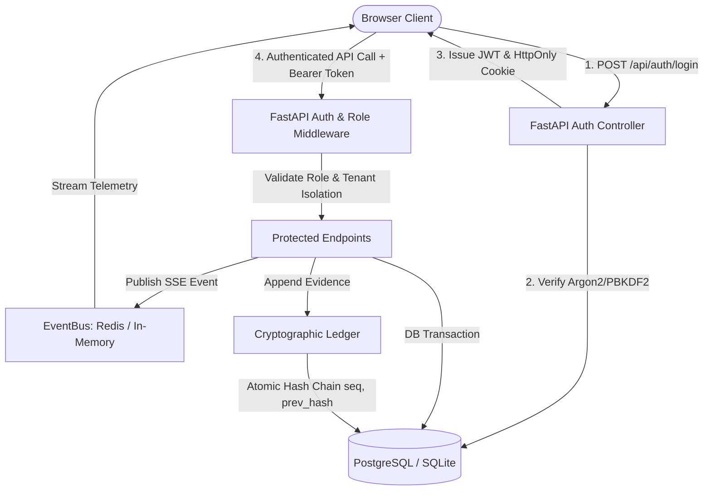

# ProofStack Phase 2: Full Architecture, Database & Security Regression Audit

**Date:** 2026-10-25  
**Baseline Commit:** `023cea3` (`Merge pull request #4 from nikhillakra2007-tech/nitin/frontend-final`)  
**Active Working Branch:** `model`  
**Author:** Senior Staff Systems & Security Architect  

---

## 1. Executive Summary

This architecture and integration audit evaluates ProofStack / Sentinel Gate at commit `023cea3` on `main`. ProofStack is designed as an autonomous performance-verification and zero-compromise security remediation platform with cryptographic evidence ledgers.

While previous PRs established UI layouts, DAST probe definitions, and initial FastAPI endpoints, several fundamental integration, security, and persistence gaps exist that prevent it from functioning as a true, locally runnable full-stack product.

### Core Verified Findings:
1. **Frontend-to-Backend Disconnect:**
   - The Next.js frontend (`frontend/src/`) relies heavily on mock data (`mockData.ts`) and simulated client-side storage (`localStorage` via `AuthContext.tsx`).
   - Several operational pages (`/studio`, `/cockpit`, `/dast`, `/ledger`) call hardcoded `http://127.0.0.1:8765` endpoints and fall back silently to fake data when requests fail or when backend returns non-200.
2. **Authentication & Authorization Vulnerabilities:**
   - The backend server previously marked operational routes (`/api/run`, `/api/audit`, `/api/heal`, `/api/ledger/verify`, `/api/dast/scans`, `/api/dast/targets`) as `PUBLIC_PATHS`, allowing unauthenticated execution.
   - Frontend login did not invoke any backend authentication endpoint; it generated a client-side mock JWT (`jwt_sentinel_developer_signed`) locally.
   - No persistent `User` or `Tenant` model existed in `backend/models.py`, meaning roles, users, and tenants were untrusted client claims.
   - CORS was configured with `allow_origins` containing `*` while `allow_credentials=True`, which is insecure and invalid under browser credential policies.
3. **SSRF Risk in DAST Scanning:**
   - `/api/dast/targets` only verified that URLs started with `http://` or `https://`, failing to restrict private network ranges (`10.0.0.0/8`, `172.16.0.0/12`, `192.168.0.0/16`), loopback (`127.0.0.1`), or link-local cloud metadata endpoints (`169.254.169.254`).
4. **Environment Configuration Mismatch:**
   - `.env.example` defined `POSTGRES_DSN`, `JWT_SECRET`, `AUTH_ALGORITHM`, `REDIS_URL`, whereas `backend/config.py` read `database_url`, `secret_key`, etc., causing divergence between documentation and execution.
5. **Database Persistence & Migrations:**
   - SQLite worked locally for dev (`proofstack.db`), but no models or migrations existed for users, authentication sessions, or persisted DAST targets/scans (which were stored in an ephemeral Python list).
   - PostgreSQL configuration needed unified connection pooling, robust retry mechanisms, and dialect-safe schemas.
6. **Ledger Integrity:**
   - While `backend/ledger_service.py` implemented hash-chained sequence hashing, concurrent append calls could race on sequence numbers without pessimistic or atomic transaction locking.
   - The global `/api/ledger/verify` endpoint was returning a hardcoded mocked JSON payload.

---

## 2. Route & Feature Inventory

### A. Frontend Routes (`frontend/src/app/`)

| Route | Role Access | Data Dependencies | API Calls | Status / Integration Gap |
|---|---|---|---|---|
| `/` | Public | Hero terminal, radar, comparisons | None (Static) | Functional presentation landing page. |
| `/login` | Public | Role presets, credentials | Currently client-only mock | **GAP:** Needs real `POST /api/auth/login` and secure session cookie/JWT. |
| `/developer` | `developer`, `admin`, `super_admin` | Diff viewer, AST inspector, telemetry | Simulated synthesize timer | **GAP:** Connect to `/api/runs/{id}/propose-patch` and `/api/heal`. |
| `/auditor` | `auditor`, `super_admin` | Merkle blocks, tamper simulator | Static mock chain | **GAP:** Connect to `/api/ledger/verify` and export real cryptographically signed packs. |
| `/admin` | `admin`, `super_admin` | MicroVM pool metrics, runner status | Static runner objects | **GAP:** Connect to `/api/health`, `/api/ready`, `/api/model/status`. |
| `/ciso` | `super_admin` | SOC2/FedRAMP matrices, override gates | Static compliance items | **GAP:** Connect to real gate policy endpoints and verified ledger status. |
| `/cockpit` | All authenticated | Finding selector, 8-gate status, AST diff | `/api/health`, `/api/heal` (fallback) | **GAP:** Use typed API client, load real runs/findings from backend. |
| `/dast` | `admin`, `super_admin`, `developer` | 12 DAST exploit probe vectors | `/api/dast/scans` (hardcoded URL) | **GAP:** Validate target URL, protect against SSRF, persist scans in database. |
| `/findings` | All authenticated | AST findings catalog, filters | Static `MOCK_FINDINGS` | **GAP:** Query backend findings table `/api/runs/{id}/findings`. |
| `/ledger` | `auditor`, `super_admin` | Merkle blocks, hash-chain tamper | `/api/ledger/verify` (hardcoded URL) | **GAP:** Connect to real database-backed SHA-256 ledger verification. |
| `/studio` | `developer`, `admin`, `super_admin` | Interactive editor, patch synthesizer | `/api/heal` (fallback) | **GAP:** Typed API client, real error states, proper authentication header. |
| `/settings` | `admin`, `super_admin` | Model engine, noise floor, policies | Client state only | **GAP:** Connect to `/api/model/status` and backend config. |

---

### B. Backend Routes (`backend/server.py`)

| Method | Path | Auth / Role | DB Entity | Side Effects | Status / Gap |
|---|---|---|---|---|---|
| `GET` | `/api/health` | Public | None | None | Working baseline. |
| `GET` | `/api/ready` | Public | `SELECT 1` | DB probe | Working baseline. |
| `POST` | `/api/auth/login` | Public | `User` | Issues JWT / HttpOnly cookie | **GAP (NEW):** Implement real authentication. |
| `POST` | `/api/auth/logout` | Authenticated | None | Clears session cookie | **GAP (NEW):** Implement logout. |
| `GET` | `/api/auth/me` | Authenticated | `User` | Returns current user & tenant | **GAP (NEW):** Implement profile retrieval. |
| `GET` | `/api/projects` | Authenticated | `Project` | Tenant filtering | Working, needs tenant isolation. |
| `POST` | `/api/projects` | Authenticated (Admin/Dev) | `Project` | Inserts project | Working, needs tenant ID binding. |
| `GET` | `/api/tasks` | Authenticated | `Task` | Filter by project | Working, needs tenant isolation. |
| `POST` | `/api/tasks` | Authenticated (Admin/Dev) | `Task` | Validates intake schema | Working. |
| `GET` | `/api/runs` | Authenticated | `Run` | Paginated listing | Working. |
| `POST` | `/api/runs` | Authenticated (Admin/Dev) | `Run` | Dispatches run | Working. |
| `POST` | `/api/runs/{id}/start` | Authenticated (Admin/Dev) | `Run` | Orchestrator background worker | Working; needs worker lifecycle safety. |
| `POST` | `/api/runs/{id}/cancel` | Authenticated (Admin/Dev) | `Run` | Marks cancelled | Working. |
| `GET` | `/api/runs/{id}/ledger` | Authenticated | `LedgerEntry` | None | Working. |
| `POST` | `/api/runs/{id}/ledger/verify` | Authenticated | `LedgerEntry` | SHA-256 chain verification | Working. |
| `GET` | `/api/ledger/verify` | Authenticated (Auditor/CISO) | `LedgerEntry` | Global ledger verification | **DEFECT:** Returns hardcoded mock, must verify real DB ledger. |
| `POST` | `/api/dast/targets` | Authenticated (Admin/Dev) | `DastTarget` | Registers target URL | **DEFECT:** In-memory only + missing SSRF protection. |
| `POST` | `/api/dast/scans` | Authenticated (Admin/Dev) | `DastScan` | Triggers DAST scanner | **DEFECT:** In-memory mock response. |
| `POST` | `/api/heal` | Authenticated (Dev/Admin) | None | Model patch generation | Working; was incorrectly public. |
| `POST` | `/api/audit` | Authenticated | None | Gate rule evaluation | Working; was incorrectly public. |
| `POST` | `/api/run` | Authenticated (Dev/Admin) | None | MicroVM simulation | Working; was incorrectly public. |

---

## 3. Architecture & Security Flow

---

## 4. Prioritized Implementation Plan

1. **Phase 3:** Unify configuration in `backend/config.py` with alias support for `POSTGRES_DSN`, `JWT_SECRET`, `AUTH_ALGORITHM`, `REDIS_URL`, and fail-fast production mode validations.
2. **Phase 4:** Add `User`, `DastTarget`, and `DastScan` models to `backend/models.py`. Create Alembic migration `005_user_auth_and_targets.py`.
3. **Phase 5:** Implement real PBKDF2/bcrypt authentication, JWT issuance, HttpOnly cookie support, role-based authorization (`require_role`), tenant isolation, and SSRF validation for external targets.
4. **Phase 6:** Audit and secure `LedgerService` with transactional integrity, real global verification, and anti-tamper tests.
5. **Phase 7:** Integrate hybrid Redis pub/sub into `EventBus` with graceful fallback to in-memory event queues and robust SSE reconnects.
6. **Phase 8:** Create typed frontend API client (`frontend/src/lib/api.ts`), integrate `AuthContext` with backend endpoints, and connect all pages (`/login`, `/cockpit`, `/studio`, `/ledger`, `/dast`, `/findings`).
7. **Phase 9:** Provide clear local developer setup (`docker-compose.yml`, seed scripts, documentation).
8. **Phase 10:** Expand test coverage (negative security tests, role checks, SSRF blocks, tenant isolation, ledger tamper verification).
